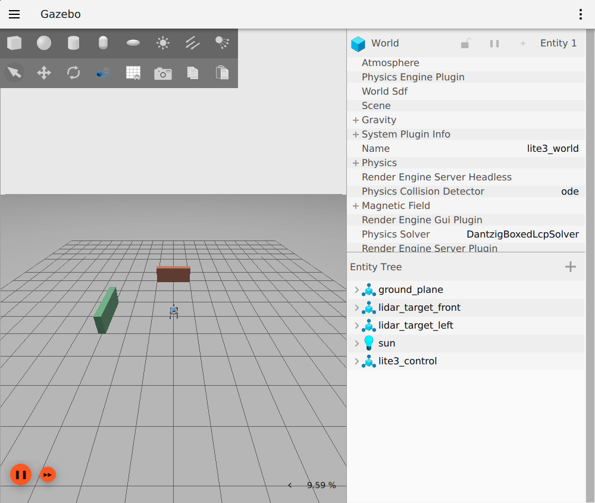
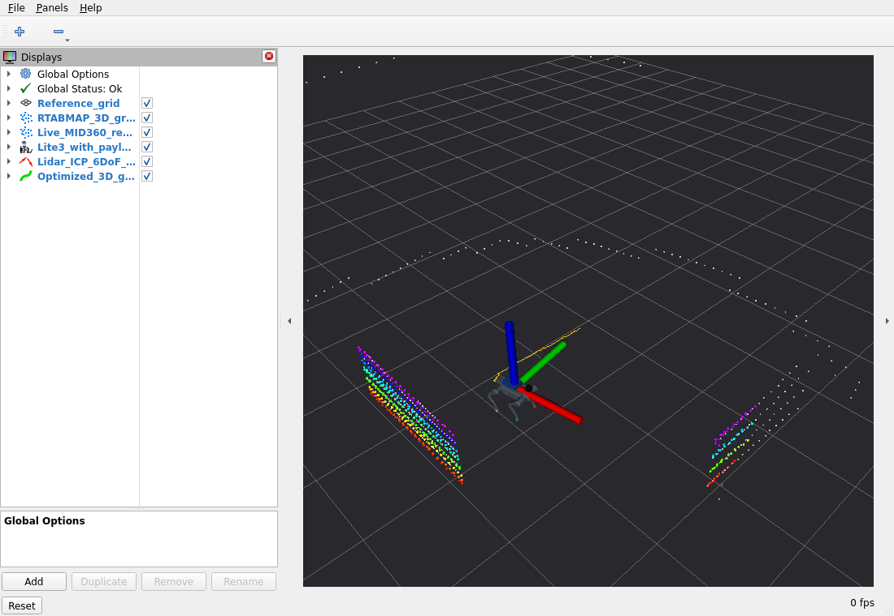
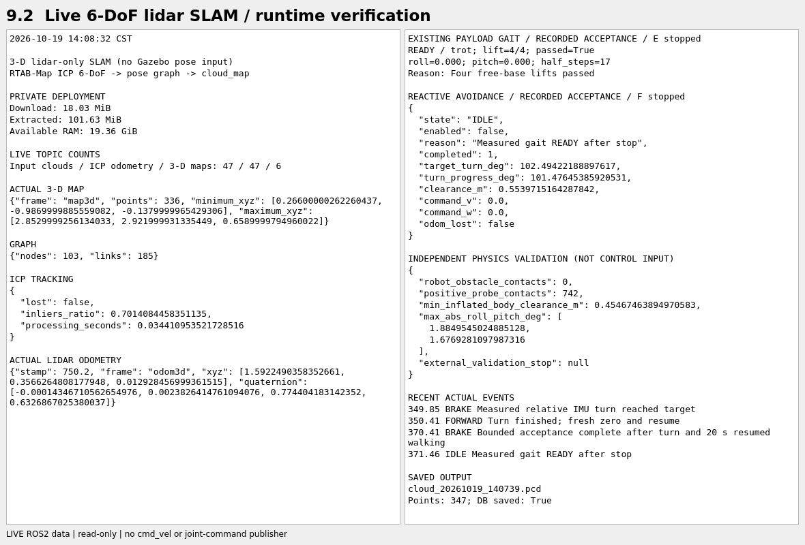
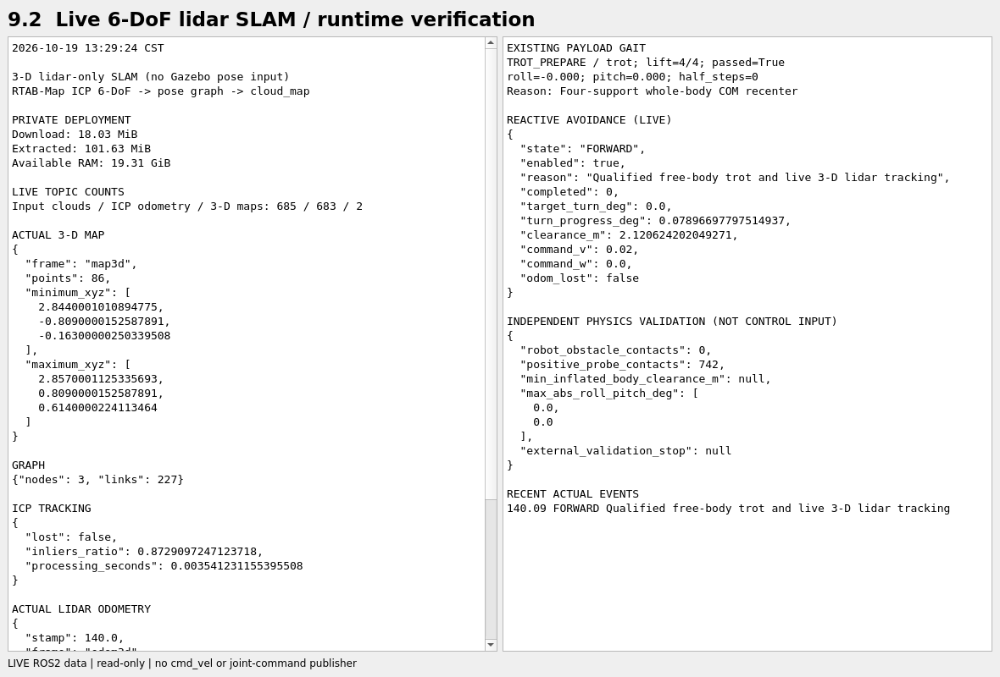
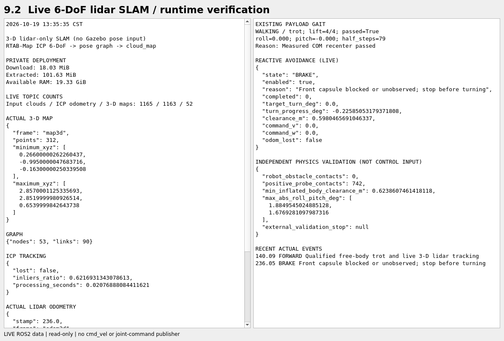
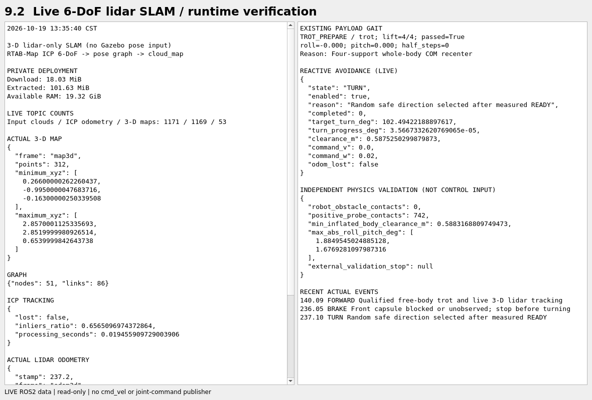
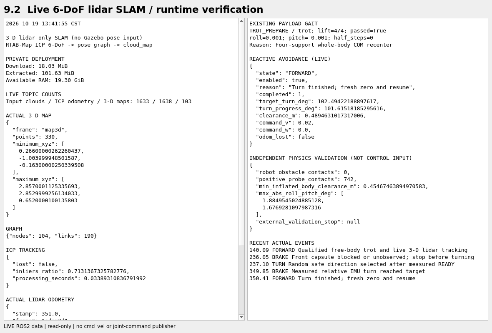
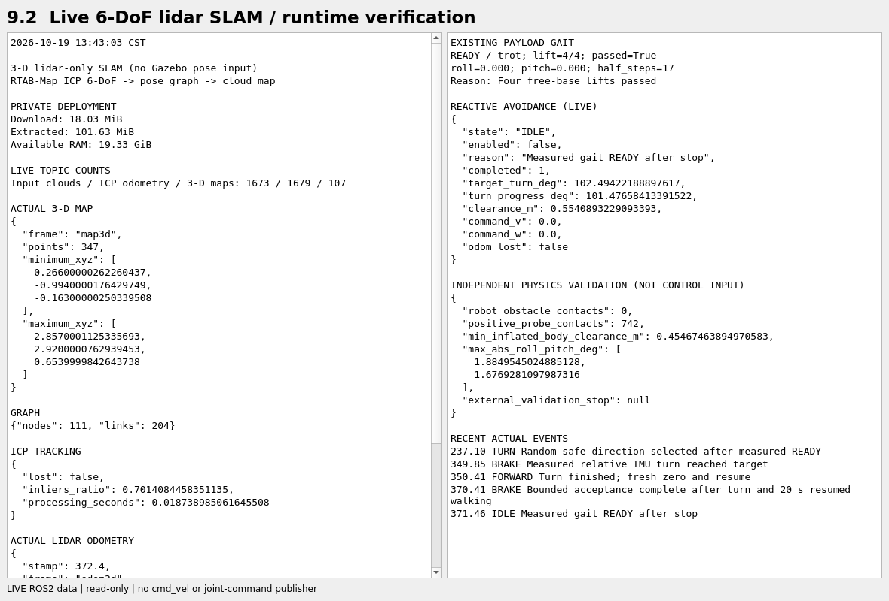
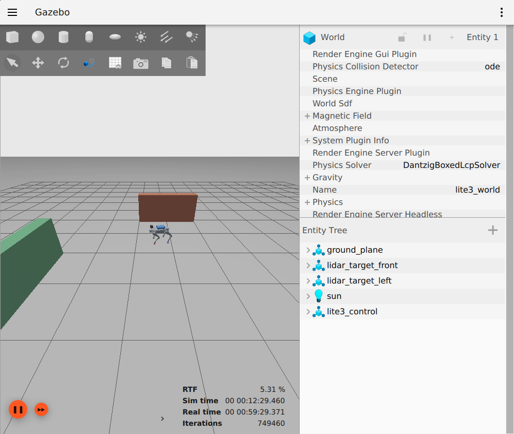

# 6.4_机器狗环境感知与导航仿真

> 环境：Orange Pi AI Pro / Ubuntu 22.04 / ROS 2 Humble / Gazebo Fortress 6.18.0  
> 部署日期：2026-10-16  
> 本节新增/修改的项目文件仅位于 `/home/HwHiAiUser/catkin_ws_lite3dog/src/06_simulationmode_grazebo/6-4_robot_navigation`。

## 1. 本次实现与兼容性

保留原Lite3模型、6-3步态代码、配置和安装副本，参考中的ROS 2插件确实支持ROS 2，但它的CMake仍依赖`gazebo_dev`、`gazebo_ros`、Gazebo 11头文件和Classic的RayPlugin/GpuRayPlugin。它不能直接作为Fortress系统插件加载。原Livox-SDK仓库则面向ROS 1/Gazebo 9。

本版采用Fortress已有`Sensors`系统与`gpu_lidar`，通过已有`ros_gz_bridge`输出标准PointCloud2。它近似MID-360的360°水平、-7°～52°竖直视场，外壳按65×65×60mm、265g设置。外壳是简单几何外观，不是官方MID-360 CAD网格。

**本版是视场/几何点云仿真，不复现MID-360非重复CSV扫描、逐点时间、网络协议或Livox CustomMsg。**不能直接宣称可供要求Livox专有消息与点时间字段的FAST-LIO配置使用。纯仿真点云不需要安装实物Livox驱动。

## 2. box.SLDPRT转换结果

通过本机已有SolidWorks 2022 SP5 API只读打开源文件，导出真实STL，不是随意生成替代盒子。原Desktop源文件未保存或修改。导出后将毫米转换为米，并将网格原点平移至包围盒中心。

| 项目 | 结果 |
| --- | --- |
| 原文件 | box.SLDPRT |
| 实际尺寸 | 206 × 140.7 × 52 mm |
| 网格 | meshes/box.stl；12个三角面，单位米 |
| 独立URDF | urdf/box.urdf |
| CAD质量 | 1.5071784kg |
| CAD质量说明 | 当前CAD材料/密度的计算值，需核对实物与内部设备总重 |
| MID-360近似质量 | 0.265kg |
| 默认额外质量合计 | 约1.772kg，不包含额外支架/线缆 |

STL只保存表面几何，URDF补充质量、惯量、碰撞及安装关节。此零件是矩形实体，使用相同尺寸box作为碰撞体，视觉仍使用真实导出网格，避免复杂网格碰撞开销。默认惯量按均匀实体盒计算，与当前CAD惯量相符；真实空壳装配的质量分布需要重新确认。

挂点相对TORSO（米）：

| 部件 | 中心/原点xyz | 说明 |
| --- | --- | --- |
| 背部box | -0.04, 0, 0.101 | 底面z=0.075，高于原机身碰撞顶面0.07约5mm |
| 雷达外壳 | 0.22, 0, 0.145 | 机身前上方；x正方向为前方 |
| 雷达扫描原点 | 0.22, 0, 0.175 | 高于外壳中心30mm，也高于背部box顶部 |

挂点为当前模型安装建议，不代表实物支架设计已经完成。两个挂件通过固定关节连接TORSO，不改变12个腿部关节名称。

## 3. 目录与输出

## 项目架构

```text
6-4_robot_navigation/
├── 6.4_机器狗环境感知与导航仿真.md
├── cad/box.SLDPRT                    原文件副本
├── cad/export_box.ps1                Windows已有SolidWorks API导出脚本
├── cad/box_export.json               CAD尺寸/质量/惯量与单位记录
├── convert_box_mesh.py               STL归一化（只用于转换原始导出）
├── meshes/box.stl                    米制居中网格
├── meshes/box_raw.STL                原始导出网格（毫米）
├── urdf/box.urdf                     独立载荷URDF
├── launch/lite3_navigation_spawn.launch.py
├── launch/navigation_attachments.py
├── pointcloud_frame.py
├── worlds/lite3_navigation.sdf
├── rviz/lite3_mid360.rviz
├── tests/test_navigation.py
├── tests/runtime_probe.py
└── .runtime/                        生成URDF与本节测试日志
```

导航世界复制现有平地物理配置，在本目录中增加Sensors插件和前方/左方两个简单静态点云靶标；世界名仍为`lite3_world`。启动文件生成`.runtime/lite3_navigation.urdf`，其中包含原Lite3、雷达、载荷及原有控制插件。

| 话题/坐标 | 含义 |
| --- | --- |
| /lite3_sim/mid360/scan/points | Gazebo原生PointCloudPacked |
| /lite3_sim/mid360/points_raw | ROS桥接后的原始PointCloud2 |
| /lite3_sim/mid360/points | 对齐ROS光学坐标名的PointCloud2 |
| mid360_optical_frame | 点坐标所在的ROS TF帧 |
| /lite3_sim/model_pose | 现有模型位姿反馈 |
| /lite3_sim/robot_description | 包含新挂件的完整模型描述 |

frame转发只更正Gazebo作用域帧名，保持原点、XYZ、数据、时间戳和字段不变，不生成逐点时间字段。

## 4. SSH实际验证结果

使用独立Gazebo分区和ROS域31做限时测试，原有域30仿真未被停止或接收关节命令。服务器与子进程放在2GiB内存上限的临时测试范围内，RSS超过约1.17GiB会停止。验证完已退出本次所有进程。

自由机身测试结果：

```text
joint_state_broadcaster：Configured and activated
lite3_leg_controller：Configured and activated
ROS点云消息：26帧（本次18秒墙钟观察窗口内）
点云仿真时间频率：5.0 Hz
width=180, height=12
有效点：末帧437
四象限：frontleft / frontright / backleft / backright
字段：x, y, z, intensity, ring
frame_id：mid360_optical_frame
机身Z：约0.34385m
服务器RSS观察峰值：约433.6MiB
```

**本节记录的是挂载与静置初测，不包含带载荷动态Trot、90°转向、SLAM或自动导航验收。**原6-3步态节点的COM模型读取原URDF，未自动加入这两个挂件，因此不要把原空载步态的通过结论直接用于本模型。后续第8节使用6-4独立入口读取实际挂载URDF的COM；第9节增加标准二维SLAM流程，各阶段须分别验收。

## 5. 从头启动A～F（本节传感器静置验收）

### 5.1 准备与旧实例退出

先在原F停止速度发布，正常时发零速度与stop_gait、等READY，再依次结束旧E、C、B、A。若旧步态已经FAULT，先保存日志，停止速度发布和旧控制节点；不要再次enable尝试绕过。

```bash
pgrep -af 'ign gazebo|lite3_spawn.launch.py|lite3_navigation_spawn|lite3_controller|lite3_gait.launch.py'
```

残留旧实例时回对应终端结束，避免两个`lite3_world`或重名controller_manager。

每个新终端先执行：

```bash
source "$HOME/catkin_ws_lite3dog/src/06_simulationmode_grazebo/6-3_robot_sport/env/lite3_env.bash"
export ROS_DOMAIN_ID=30
NAV="$HOME/catkin_ws_lite3dog/src/06_simulationmode_grazebo/6-4_robot_navigation"
export ROS_LOG_DIR="$NAV/.runtime/ros_log"
export PYTHONDONTWRITEBYTECODE=1
```

### 5.2 A：本节唯一世界服务器

在已有可用DISPLAY的X11终端中执行：

```bash
source "$HOME/catkin_ws_lite3dog/src/06_simulationmode_grazebo/6-3_robot_sport/env/lite3_env.bash"
export ROS_DOMAIN_ID=30
NAV="$HOME/catkin_ws_lite3dog/src/06_simulationmode_grazebo/6-4_robot_navigation"
export ROS_LOG_DIR="$NAV/.runtime/ros_log"
export PYTHONDONTWRITEBYTECODE=1
echo "$DISPLAY"
ign gazebo -s -v 4 "$NAV/worlds/lite3_navigation.sdf"
```

沿用A的`-s -v 4`方式，不添加-r。**本世界增加了渲染型雷达，A也需要可用的OpenGL显示连接。**本次测试使用已存在的Moba/X转发并成功出点云；不要把测试时的localhost:10.0硬编码到新SSH，它会随会话变化。

如果DISPLAY为空，使用已能显示Gazebo的MobaXterm X11会话启动A。不要安装Classic或随意更换全局显卡配置。A不返回提示符正常。

### 5.3 B：GUI

```bash
source "$HOME/catkin_ws_lite3dog/src/06_simulationmode_grazebo/6-3_robot_sport/env/lite3_env.bash"
export ROS_DOMAIN_ID=30
NAV="$HOME/catkin_ws_lite3dog/src/06_simulationmode_grazebo/6-4_robot_navigation"
export ROS_LOG_DIR="$NAV/.runtime/ros_log"
export PYTHONDONTWRITEBYTECODE=1
ign gazebo -g -v 4
```

只打开一个GUI。

### 5.4 C：生成带挂件的模型与桥接

```bash
source "$HOME/catkin_ws_lite3dog/src/06_simulationmode_grazebo/6-3_robot_sport/env/lite3_env.bash"
export ROS_DOMAIN_ID=30
NAV="$HOME/catkin_ws_lite3dog/src/06_simulationmode_grazebo/6-4_robot_navigation"
export ROS_LOG_DIR="$NAV/.runtime/ros_log"
export PYTHONDONTWRITEBYTECODE=1
ign service -l | grep '/world/lite3_world/create'
```

服务出现后：

```bash
export ROS_LOG_DIR="$NAV/.runtime/ros_log"
PATH="/usr/bin:$PATH" ros2 launch "$NAV/launch/lite3_navigation_spawn.launch.py" \
  pin_body:=false enable_lidar:=true with_payload:=true
```

这里是已存在的绝对路径launch文件，不需要创建或编译新包。

C只执行一次，create正常退出后仍保留其他节点。B点击播放，让模型落地。可以看到前上方黑色雷达外壳、背部蓝色CAD载荷，以及两个静态靶标。

如实际载荷质量已知，例如0.6kg，只在C启动时附加`payload_mass:=0.6`；该值会同时缩放载荷惯量。已经生成模型后需要结束本轮并重建，不会热修改既有模型。

### 5.5 D：原有两个控制器

```bash
source "$HOME/catkin_ws_lite3dog/src/06_simulationmode_grazebo/6-3_robot_sport/env/lite3_env.bash"
export ROS_DOMAIN_ID=30
NAV="$HOME/catkin_ws_lite3dog/src/06_simulationmode_grazebo/6-4_robot_navigation"
source "$NAV/env/cli_env.bash"
export ROS_LOG_DIR="$NAV/.runtime/ros_log"
export PYTHONDONTWRITEBYTECODE=1
ros2 node list --no-daemon | grep -x '/lite3_sim/controller_manager' | wc -l
ros2 control list_controllers -c /lite3_sim/controller_manager
```

要求manager只有1个。只在对应控制器尚未加载时执行：

```bash
ros2 run controller_manager spawner joint_state_broadcaster -c /lite3_sim/controller_manager --controller-manager-timeout 60 --switch-timeout 120
ros2 run controller_manager spawner lite3_leg_controller -c /lite3_sim/controller_manager --controller-manager-timeout 60 --switch-timeout 120
ros2 control list_controllers -c /lite3_sim/controller_manager
```

两个active后停止重复spawner。超时后先查实际状态，不重复配置已active控制器。B在激活期间保持播放。

### 5.6 E：只读点云与机身验证

本节E先用于传感器检查，**不启动原空载Trot节点**：

```bash
source "$HOME/catkin_ws_lite3dog/src/06_simulationmode_grazebo/6-3_robot_sport/env/lite3_env.bash"
export ROS_DOMAIN_ID=30
NAV="$HOME/catkin_ws_lite3dog/src/06_simulationmode_grazebo/6-4_robot_navigation"
source "$NAV/env/cli_env.bash"
export ROS_LOG_DIR="$NAV/.runtime/ros_log"
export PYTHONDONTWRITEBYTECODE=1
/usr/bin/python3 "$NAV/tests/runtime_probe.py"
```

该脚本只读观察18秒墙钟时间后自动退出，结果保存本节`.runtime/pointcloud_probe.json`。要求clouds增加、finite_points大于0、frame正确，并检查机身Z没有明显下沉。


持续查看频率可用：

```bash
timeout 12s ros2 topic hz /lite3_sim/mid360/points --window 30
```

5Hz是仿真时间频率；墙钟频率随实时率下降而变低，不能只看`topic hz`就认定丢帧。大部分光束朝天空时出现inf/无效点正常；靶标和地面方向应有有限点。

### 5.7 F：TF与RViz显示（已有RViz时）

```bash
source "$HOME/catkin_ws_lite3dog/src/06_simulationmode_grazebo/6-3_robot_sport/env/lite3_env.bash"
export ROS_DOMAIN_ID=30
NAV="$HOME/catkin_ws_lite3dog/src/06_simulationmode_grazebo/6-4_robot_navigation"
export ROS_LOG_DIR="$NAV/.runtime/ros_log"
export PYTHONDONTWRITEBYTECODE=1
ros2 run tf2_ros tf2_echo TORSO mid360_optical_frame
```

确认平移约为0.22、0、0.175，Ctrl+C退出只读查询。已有RViz时启动：

```bash
ros2 run rviz2 rviz2 -d "$NAV/rviz/lite3_mid360.rviz" --ros-args -p use_sim_time:=true
```


Fixed Frame设为TORSO，PointCloud2为`/lite3_sim/mid360/points`、Best Effort。RobotModel读取`/lite3_sim/robot_description`。不要直接把Fixed Frame选成map；第9节启动SLAM后再使用map。

若未安装RViz，不自动安装；E的点云与TF检查已可验证数据链路。GUI与RViz同时开会增加CPU与内存，先短时观察。

## 6. 参数、资源与回退

C的可选参数：

| 参数 | 默认值 | 范围/用途 |
| --- | --- | --- |
| enable_lidar | true | false时保留外壳和TF，但不产生点云 |
| with_payload | true | false时不安装背部box |
| payload_mass | 1.5071784 | kg，0～5之间且不含0；需据实设置 |
| lidar_hz | 5.0 | 1～10Hz，先低负载 |
| horizontal_samples | 180 | 32～720 |
| vertical_samples | 12 | 2～32 |
| pin_body | false | true只用于固定机身传感器检查 |

默认每秒10800个采样槽位，不是实物MID-360的200000点/秒。不直接照搬24000点×10Hz，尤其当前软件渲染路径已经有GUI资源异常记录。

```bash
free -h
ps -eo pid,rss,pcpu,args --sort=-rss | head -8
```

## 8. 带载荷低速行走：从头启动A～F

### 8.1 本阶段入口与边界

带载入口为本目录的`payload_controller.py`，配置为`config/payload_crawl.yaml`。它只读复用已安装的Lite3控制算法，将COM计算切换到C生成的`.runtime/lite3_navigation.urdf`，纳入背部载荷和雷达质量，并核对模型描述指纹，避免模型与控制COM不一致。

本阶段采用**单腿依次摆动的crawl慢走，速度0.002m/s**。它不是两组对角腿同时摆动的Trot，不直接沿用空载0.02m/s验收结论。雷达、CAD载荷及原12个腿关节同时保留。不修改6-3源码、配置、安装副本或全局环境。

默认CAD载荷1.5071784kg、雷达0.265kg；如果实物箱体只是空壳，应先核对真实总质量，不能通过随意减小质量来宣称带载通过。更换C的`payload_mass`后须重新生成模型并重启E，让两者读取同一模型。

### 8.2 准备：结束旧实例，每个终端统一域

F停止旧速度发布。正常运动时先发零速度与停止请求、等READY；随后依次结束旧E、C、B、A。旧状态若为FAULT，保留错误，停止速度发布和旧控制节点，重新建立本轮初始状态，不重复enable绕过故障。

```bash
pgrep -af 'ign gazebo|lite3_navigation_spawn|lite3_spawn.launch.py|payload_controller|lite3_controller|lite3_gait.launch.py'
```

残留进程返回它所属终端结束，不批量结束其他工作目录的程序。下面只启动一套`lite3_world`与一台Lite3。A执行后持续占用终端正常，不重复开第二个A。

每个新终端都加载原有环境并显式设域；下面各节仍提供完整命令，方便独立复制。

```bash
source "$HOME/catkin_ws_lite3dog/src/06_simulationmode_grazebo/6-3_robot_sport/env/lite3_env.bash"
export ROS_DOMAIN_ID=30
NAV="$HOME/catkin_ws_lite3dog/src/06_simulationmode_grazebo/6-4_robot_navigation"
export ROS_LOG_DIR="$NAV/.runtime/ros_log"
export PYTHONDONTWRITEBYTECODE=1
```

### 8.3 A：唯一世界服务器

使用已有可用DISPLAY的X11终端：

```bash
source "$HOME/catkin_ws_lite3dog/src/06_simulationmode_grazebo/6-3_robot_sport/env/lite3_env.bash"
export ROS_DOMAIN_ID=30
NAV="$HOME/catkin_ws_lite3dog/src/06_simulationmode_grazebo/6-4_robot_navigation"
export ROS_LOG_DIR="$NAV/.runtime/ros_log"
export PYTHONDONTWRITEBYTECODE=1
echo "$DISPLAY"
ign gazebo -s -v 4 "$NAV/worlds/lite3_navigation.sdf"
```

沿用已验证的`-s -v 4`，不加`-r`。本世界的gpu_lidar需要A的可用OpenGL显示连接；不能把别的SSH会话中的DISPLAY值硬编码过来。

### 8.4 B：GUI

```bash
source "$HOME/catkin_ws_lite3dog/src/06_simulationmode_grazebo/6-3_robot_sport/env/lite3_env.bash"
export ROS_DOMAIN_ID=30
NAV="$HOME/catkin_ws_lite3dog/src/06_simulationmode_grazebo/6-4_robot_navigation"
export ROS_LOG_DIR="$NAV/.runtime/ros_log"
export PYTHONDONTWRITEBYTECODE=1
ign gazebo -g -v 4
```

只打开一个Gazebo GUI；旧RViz也只保留一个，启动H前退出先前静态显示的RViz。完成C后点击播放，让机身落地；D加载和激活期间一直保持播放。

### 8.5 C：只生成一次自由机身、雷达与载荷

```bash
source "$HOME/catkin_ws_lite3dog/src/06_simulationmode_grazebo/6-3_robot_sport/env/lite3_env.bash"
export ROS_DOMAIN_ID=30
NAV="$HOME/catkin_ws_lite3dog/src/06_simulationmode_grazebo/6-4_robot_navigation"
export ROS_LOG_DIR="$NAV/.runtime/ros_log"
export PYTHONDONTWRITEBYTECODE=1
ign service -l | grep '/world/lite3_world/create'
```

服务出现后：

```bash
export ROS_LOG_DIR="$NAV/.runtime/ros_log"
PATH="/usr/bin:$PATH" ros2 launch "$NAV/launch/lite3_navigation_spawn.launch.py" \
  pin_body:=false enable_lidar:=true with_payload:=true
```

create子进程退出正常；桥接、robot_state_publisher、点云frame转发仍需保持运行。此时B中应出现背部箱体和前上方雷达。**不要再运行6-3的生成入口或重复生成第二台狗。**


### 8.6 D：按状态加载控制器并观察反馈

```bash
source "$HOME/catkin_ws_lite3dog/src/06_simulationmode_grazebo/6-3_robot_sport/env/lite3_env.bash"
export ROS_DOMAIN_ID=30
NAV="$HOME/catkin_ws_lite3dog/src/06_simulationmode_grazebo/6-4_robot_navigation"
source "$NAV/env/cli_env.bash"
export ROS_LOG_DIR="$NAV/.runtime/ros_log"
export PYTHONDONTWRITEBYTECODE=1
ros2 node list --no-daemon | grep -x '/lite3_sim/controller_manager' | wc -l
ros2 control list_controllers -c /lite3_sim/controller_manager
```

manager数量必须为1。若显示`No controllers are currently loaded!`，逐条执行：

```bash
ros2 run controller_manager spawner joint_state_broadcaster \
  -c /lite3_sim/controller_manager --controller-manager-timeout 60 --switch-timeout 120
```

第一条执行完再执行第二条：

```bash
ros2 run controller_manager spawner lite3_leg_controller \
  -c /lite3_sim/controller_manager --controller-manager-timeout 60 --switch-timeout 120
```

不要因客户端出现超时就不断重复spawner，先查询实际状态：

```bash
ros2 control list_controllers -c /lite3_sim/controller_manager
```

| 当前状态 | 下一步 |
| --- | --- |
| 未加载 | 只为缺少的控制器运行一次spawner |
| unconfigured | 先配置为inactive，再激活 |
| inactive | 只激活，不重新加载或配置 |
| active | 已完成，停止重复操作 |

仅对实际为unconfigured的项目执行相应配置命令：

```bash
ros2 control set_controller_state joint_state_broadcaster inactive -c /lite3_sim/controller_manager
ros2 control set_controller_state lite3_leg_controller inactive -c /lite3_sim/controller_manager
```

仅对实际为inactive的项目执行相应激活命令，每条等待返回：

```bash
ros2 service call /lite3_sim/controller_manager/switch_controller \
  controller_manager_msgs/srv/SwitchController \
  '{activate_controllers: [joint_state_broadcaster], deactivate_controllers: [], strictness: 2, activate_asap: true, timeout: {sec: 120, nanosec: 0}}'
```

```bash
ros2 service call /lite3_sim/controller_manager/switch_controller \
  controller_manager_msgs/srv/SwitchController \
  '{activate_controllers: [lite3_leg_controller], deactivate_controllers: [], strictness: 2, activate_asap: true, timeout: {sec: 120, nanosec: 0}}'
```

如果激活等待，先在B确认播放。也可另开终端，仅恢复播放，不重置模型与时钟：

```bash
ign service -s /world/lite3_world/control \
  --reqtype ignition.msgs.WorldControl --reptype ignition.msgs.Boolean \
  --timeout 5000 --req 'pause: false'
```

两个控制器active后检查三种反馈：

```bash
timeout 8s ros2 topic echo /clock --once --qos-reliability best_effort
timeout 8s ros2 topic echo /lite3_sim/joint_state_broadcaster/joint_states --once --qos-reliability best_effort
timeout 8s ros2 topic echo /lite3_sim/model_pose --once
```

均有输出再启动E。D随后观察状态：

```bash
ros2 topic echo /lite3_sim/gait_status --field data
```

E尚未启动时此话题可能不存在，先启动E再观察即可，不能因此重新加载控制器。

### 8.7 E：带载crawl控制器

```bash
source "$HOME/catkin_ws_lite3dog/src/06_simulationmode_grazebo/6-3_robot_sport/env/lite3_env.bash"
export ROS_DOMAIN_ID=30
NAV="$HOME/catkin_ws_lite3dog/src/06_simulationmode_grazebo/6-4_robot_navigation"
source "$NAV/env/cli_env.bash"
export ROS_LOG_DIR="$NAV/.runtime/ros_log"
export PYTHONDONTWRITEBYTECODE=1
export ROS_LOG_DIR="$NAV/.runtime/ros_log"
/usr/bin/python3 "$NAV/payload_controller.py" --ros-args \
  --params-file "$NAV/config/payload_crawl.yaml"
```

启动E前可用`ros2 topic info /lite3_sim/lite3_leg_controller/joint_trajectory --verbose`确认旧步态发布者已退出；E启动后应仅有本入口一个发布者。

预期日志含`NAVIGATION_PAYLOAD: mode=crawl`、读取本节挂载URDF及总质量。初始DISARMED正常，`mode=crawl`与本阶段一致；需要对角连续行走则使用第13节E入口。E持续运行；同时不要运行原6-3 E、phase_demo或额外关节轨迹发布器。

如果日志提示`Mounted robot_description differs from COM model`，停止本轮并检查C/E是否来自同一轮生成文件，不跳过指纹校验。


### 8.8 F：使能、四腿抬脚、0.002m/s前进

```bash
source "$HOME/catkin_ws_lite3dog/src/06_simulationmode_grazebo/6-3_robot_sport/env/lite3_env.bash"
export ROS_DOMAIN_ID=30
NAV="$HOME/catkin_ws_lite3dog/src/06_simulationmode_grazebo/6-4_robot_navigation"
source "$NAV/env/cli_env.bash"
export ROS_LOG_DIR="$NAV/.runtime/ros_log"
export PYTHONDONTWRITEBYTECODE=1
ros2 service call /lite3_sim/enable_gait std_srvs/srv/Trigger '{}'
```

等D执行这个命令 ```ros2 topic echo /lite3_sim/gait_status --field data``` 从站姿过渡返回READY后，再执行：

```bash
ros2 service call /lite3_sim/test_foot_lift std_srvs/srv/Trigger '{}'
```

不用W。必须等四腿逐一完成并重新回到READY，确认`lift_test=4/4`、`lift_passed=True`；一次服务返回success只表示测试被接受，不等于四腿验收完成。

记录本轮起点：

```bash
ros2 topic echo /lite3_sim/model_pose --once
```


测试结束后先发零速度解除新的运动确认，再持续前进：

```bash
ros2 topic pub --once /lite3_sim/cmd_vel geometry_msgs/msg/Twist \
  '{linear: {x: 0.0}, angular: {z: 0.0}}'

ros2 topic pub --rate 20 /lite3_sim/cmd_vel geometry_msgs/msg/Twist \
  '{linear: {x: 0.002}, angular: {z: 0.0}}'
```

本轮先看四条腿均完成一轮支撑/摆动、机身有前向净位移、没有FAULT；按仿真时间而非墙钟估算进度。不能在还未完成时因为慢就连续加速。


停止时在F按Ctrl+C，立即执行：

```bash
ros2 topic pub --once /lite3_sim/cmd_vel geometry_msgs/msg/Twist \
  '{linear: {x: 0.0}, angular: {z: 0.0}}'
ros2 service call /lite3_sim/stop_gait std_srvs/srv/Trigger '{}'
```

E保持运行，等四脚落地并返回READY，再记录终点：

```bash
ros2 topic echo /lite3_sim/model_pose --once
```

带载行走验收要求：四腿抬脚通过；前向净位移；机身没有持续下沉或倾覆；停止后READY；雷达点云仍有有效回波。出现FAULT时保存E完整错误和D的reason，不手动发布全零关节、不直接改故障阈值。

带载前进通过后可单独测试后退：每次换方向均先停止并等READY，再发一次零速度，将连续命令中的`linear.x`改为`-0.002`。左右转先用`linear.x=0.0`、`angular.z=±0.005`分别短时验收；本节没有宣称带载90°转向或带载Trot已经通过。

## 9. 三维激光 SLAM：沿用现有 Lite3、载荷和地图

本节取代旧第九节之后的二维建图流程；第一至第八节保留。以下步骤用于三维建图与避障，不要同时运行旧的 `lite3_slam.launch.py`、`sim_odometry.py`、二维 SLAM 或旧的速度发布终端。

升级日期：2026-10-19。前文提及的“第九节标准二维 SLAM”是旧版引用，以本节新的三维链路为准。

### 9.1 本次采用的三维链路与目录

环境仍是香橙派、Ubuntu 22.04、ROS 2 Humble、Gazebo Fortress 6.18.0。保留已验证的 Lite3 模型、背部载荷、头顶雷达和原地图中的两面障碍物。本次文件全部放在：

```text
/home/HwHiAiUser/catkin_ws_lite3dog/src/06_simulationmode_grazebo/6-4_robot_navigation
```

三维定位与建图采用 RTAB-Map 的六自由度激光 ICP 里程计和位姿图，不再通过 Gazebo 真值里程计给 SLAM 提供位置。实际链路为：

```text
/lite3_sim/mid360/points
  ├─ icp_odometry → /lite3_sim/slam3d/odom
  └─ RTAB-Map + ICP 里程计 → /lite3_sim/slam3d/cloud_map
                              /lite3_sim/slam3d/mapGraph
                              /lite3_sim/slam3d/mapPath

TF：map3d → odom3d → TORSO → mid360_optical_frame
```

`map3d` 是三维建图坐标系。`Optimizer/Slam2D=false`，`Reg/Force3DoF=false`，`Grid/3D=true`；显示的是三维点云地图，不能把仅显示一帧原始点云当作三维 SLAM。Gazebo 的 `/lite3_sim/model_pose` 仅用于步态测量和独立验收，不输入 ICP 或避障决策。

RTAB-Map 依赖已私有部署到本目录 `.runtime/slam3d_root`，下载共 18.03 MiB，解包后的包清单体积约 101.63 MiB。没有执行全局 `apt install`，没有修改 `/opt/ros`、6-3 源码或其他工作空间。已部署的机器直接使用即可；只有私有目录缺失时才执行：

```bash
NAV="$HOME/catkin_ws_lite3dog/src/06_simulationmode_grazebo/6-4_robot_navigation"
/usr/bin/python3 "$NAV/install_slam3d_private.py"
```

原始 `worlds/lite3_navigation.sdf` 保留；`prepare_guarded_world.py` 生成 `worlds/lite3_navigation_guarded.sdf`，为现有两个障碍物增加接触传感器。模型位置、几何和碰撞体不变，物理步长仍为 0.001 秒。生成副本的目标实时倍率为 0.5，实际倍率以现场统计为准；它不改变步态使用的仿真时间周期。

C 在 6-4 的 `.runtime/navigation_controllers.yaml` 生成控制器配置副本，仅将状态反馈发布频率由 30 提到 100 个仿真 Hz，与原 100 Hz 控制更新率一致。低实时倍率时可减少墙钟时间上的反馈空隙。原 6-3 配置、关节限位、控制周期和步态超时保护不改。

当前雷达是 Fortress 原生 GPU 雷达的 MID360 视场近似，180×12、仿真时间 5 Hz。它不是 Livox 非重复扫描插件，数据没有逐点时间，不伪造 FAST-LIO 所需的逐点采样时间。本节因此使用可直接消费现有 `PointCloud2` 的激光 SLAM。



### 9.2 从头启动 A～F：先确认带载 Trot 与反馈

先正常停止旧速度发布和旧 E，等待四脚落地；再结束旧 SLAM、RViz、C、B、A。不要同时启动两个世界或两个步态控制器。若准备退出的 ROS 命令失去响应，可使用本目录已有 `run_guarded.py`；不要对所有 Python 或 Gazebo 进程执行批量强杀。

**A～I 每一个新终端都先执行同一组环境命令：**

```bash
NAV="$HOME/catkin_ws_lite3dog/src/06_simulationmode_grazebo/6-4_robot_navigation"
source "$NAV/env/slam3d_env.bash"
export ROS_DOMAIN_ID=30
export PATH="/usr/bin:$PATH"
unset IGN_IP
```

这里统一使用 Gazebo 自动选择的本机接口；A、B、C 和 `ign` 查询终端必须一致。不要在其中一个终端单独再次 source 设置 `IGN_IP=127.0.0.1` 的 `gazebo_env.bash`，与其他已启动进程混用。ROS DDS 使用本目录既有 UDP 配置，环境仅影响当前终端。

**A：生成场景副本，启动唯一服务器。**

```bash
/usr/bin/python3 "$NAV/prepare_guarded_world.py" --real-time-factor 0.5
ign gazebo -s -v 4 "$NAV/worlds/lite3_navigation_guarded.sdf"
```

A 是持续运行的服务器，前台不返回命令提示符属于正常情况。不要在 A 里面继续输入下一条命令。

**B：打开 GUI。**

```bash
ign gazebo -g -v 4
```

**C：创建一次自由机身带载模型。**

```bash
ign service -l | grep -x '/world/lite3_world/create'
ros2 launch "$NAV/launch/lite3_navigation_spawn.launch.py" \
  pin_body:=false enable_lidar:=true with_payload:=true
```

创建子进程正常退出后继续保留 C；桥接和 robot_state_publisher 仍需要运行。在 B 点击播放，或者在另一个已加载相同环境的终端执行：

```bash
ign service -s /world/lite3_world/control \
  --reqtype ignition.msgs.WorldControl --reptype ignition.msgs.Boolean \
  --timeout 5000 --req 'pause: false'
```

**D：按当前状态加载控制器。**

```bash
ros2 node list --no-daemon | grep -x '/lite3_sim/controller_manager' | wc -l
ros2 control list_controllers -c /lite3_sim/controller_manager
```

manager 必须只有一个。仅当列表中没有对应控制器时逐条加载，每条等结果：

```bash
ros2 run controller_manager spawner joint_state_broadcaster \
  -c /lite3_sim/controller_manager --controller-manager-timeout 60 \
  --switch-timeout 120 --service-call-timeout 150

ros2 run controller_manager spawner lite3_leg_controller \
  -c /lite3_sim/controller_manager --controller-manager-timeout 60 \
  --switch-timeout 120 --service-call-timeout 150
```

若提示超时，先查真实状态；已 `active` 的不重复 spawner。`unconfigured` 先配置为 `inactive`，`inactive` 再激活。Gazebo 必须保持播放：

```bash
ros2 control list_controllers -c /lite3_sim/controller_manager
# 仅对实际为 unconfigured 的那个控制器执行配置，例如：
ros2 control set_controller_state joint_state_broadcaster inactive -c /lite3_sim/controller_manager
# 仅对实际为 inactive 的那个控制器执行激活，例如：
ros2 service call /lite3_sim/controller_manager/switch_controller \
  controller_manager_msgs/srv/SwitchController \
  '{activate_controllers: [joint_state_broadcaster], deactivate_controllers: [], strictness: 2, activate_asap: true, timeout: {sec: 120, nanosec: 0}}'
```

另一个控制器按其真实状态同样处理，不要直接整段重复执行。确认两个 `active`，并检查消息实际收到：

```bash
timeout -k 2s 12s ros2 topic echo /clock --once --qos-reliability best_effort
timeout -k 2s 12s ros2 topic echo /lite3_sim/joint_state_broadcaster/joint_states \
  --once --qos-reliability best_effort
```

先按 9.3 启动 G/H，以及 10.1 的接触桥接和避障节点；避障初始为 IDLE，只发零速度。等这些节点完成初始化再启动 E，避免加载图形窗口或临时插入模型时打断已使能的步态反馈。首次顺序为 A/B/C/D → G/H → 接触桥接与 F 的 IDLE 避障 → E → 另一个查询终端进行使能、资格测试和避障 start。

**E：明确选择带载对角 Trot。**

```bash
/usr/bin/python3 "$NAV/payload_controller.py" --ros-args \
  --params-file "$NAV/config/payload_crawl.yaml" -p gait_mode:=trot
```

E 保持运行。配置文件虽然叫 `payload_crawl.yaml`，入口参数明确覆盖为 Trot。不要将 crawl 的 `max_linear_speed` 改成 0.02；本节使用原有独立的 Trot 速度设置。

**F 的使能与资格操作：在 D 或额外的查询终端执行。** F 已用于运行 IDLE 避障节点，不能在其前台继续输入命令；以下命令在同环境的查询终端执行即可。

```bash
/usr/bin/python3 "$NAV/run_guarded.py" -- ros2 service call \
  /lite3_sim/enable_gait std_srvs/srv/Trigger '{}'
```

等 D 显示 `READY; phase=idle`，再执行一次：

```bash
/usr/bin/python3 "$NAV/run_guarded.py" -- ros2 service call \
  /lite3_sim/test_foot_lift std_srvs/srv/Trigger '{}'
```

D 另开观察命令，或将上面的查询结束后再观察：

```bash
/usr/bin/python3 "$NAV/run_guarded.py" -- ros2 topic echo /lite3_sim/gait_status --field data
```

等待 `READY`、`mode=trot`、`pin_body=False`、`lift_test=4/4`、`lift_passed=True`。资格检查仍逐腿抬起 HL、FL、HR、FR，这是标定；随后行走才是 FL＋HR、FR＋HL 同时交替摆腿。重复调用测试服务不会加快测试。

下图为本次四腿资格和正常停止结果的现场诊断窗口；E 结束后明确标注为已保存验收记录，左侧 SLAM 数据仍为实时输入。自动行走各阶段的实时状态截图见第十节。


### 9.3 G/H：运行三维 SLAM 并显示地图

G、H 各自先执行 9.2 的公共环境命令。G 保持运行：

```bash
ros2 launch "$NAV/launch/lite3_slam3d.launch.py"
```

每次启动默认使用一个新的时间戳数据库，不覆盖旧地图。ICP 接收实际点云，输出六自由度里程计；RTAB-Map 接收同时间戳点云和里程计，维护位姿图与三维地图。

H 打开 RViz：

```bash
ros2 run rviz2 rviz2 -d "$NAV/rviz/lite3_slam3d.rviz" --ros-args -p use_sim_time:=true
```

固定坐标系已设置为 `map3d`。界面同时显示带载机器人、实时点云、三维地图、ICP 里程计和图优化路径。地图点云可靠且为 transient-local；里程计是 best-effort，查询时需要匹配：

```bash
timeout -k 2s 15s ros2 topic echo /lite3_sim/slam3d/odom \
  --once --field pose.pose --qos-reliability best_effort
timeout -k 2s 15s ros2 topic echo /lite3_sim/slam3d/odom_info \
  --once --field lost --qos-reliability best_effort
```

`lost` 应为 `false`。世界里障碍物少、点云较稀疏，地图不会像高分辨率实机扫描一样密集。三维显示和移动建图通过，也不等于已验证大范围回环精度。

需要现场数据窗口时，再开一个只读终端：

```bash
/usr/bin/python3 "$NAV/navigation_evidence.py" --auto-capture
```

它只读取真实 ROS 数据，不发速度或关节命令。自动截图保存到 `images/slam3d/`，附带时间、窗口标题和 SHA256 清单。



### 9.4 正常停止后保存三维地图

先按 10.4 停止避障，确认四脚落地且 E 返回 `READY`。保持 G/H 运行，再执行：

```bash
/usr/bin/python3 "$NAV/save_slam3d_map.py"
```

脚本从实际 `cloud_map` 导出二进制 XYZ PCD，并调用 RTAB-Map 的 `backup` 服务保存数据库。输出在本目录 `maps/`；报告为 `.runtime/slam3d_saved_map.json`。只有 `database_backup_completed=true` 才表示数据库备份得到确认，不能只凭存在一个空文件判断保存成功。

备份操作可能暂时中断定位输出，所以在机器人停止后执行。PCD 用于查看三维几何，数据库保存关键帧与图信息；两者用途不同。

本次实际导出 `cloud_20261019_140739.pcd`，包含 347 个有限 XYZ 地图点；数据库备份为 `slam3d_20261019_130951.db.back`。稀疏雷达与两个简单障碍物决定了当前点数，不能以点数少认定它是二维图。PCD 的 Z 范围约为 −0.163～0.654 m，包含立体高度；`map3d` 以激光里程计起点定义，不等同于 Gazebo 世界坐标系的地面 Z=0。



## 10. 当前地图中的点云避障：前进、停稳、随机转向、继续

本节是当前平地与静态障碍物的局部反应式避障，不是 Nav2 全局目标导航。建图与避障并行运行；避障使用最新传感器点云，避免依赖尚未更新的地图来判断眼前障碍物。

### 10.1 启动唯一速度发布者

先结束所有手动 F 的 `ros2 topic pub ...cmd_vel`、键盘控制与旧避障脚本。E 只允许一个关节指令发布者，避障运行时 `/lite3_sim/cmd_vel` 也只能有一个发布者。

另开 I，先执行 9.2 公共环境，再启动障碍物接触桥接并保留终端：

```bash
ros2 launch "$NAV/launch/lite3_obstacle_contacts.launch.py"
```

接触桥接用于独立验收，不用于决定往哪个方向走。正常避障不应等发生接触后才停止。

F 加载相同环境，启动避障节点：

```bash
/usr/bin/python3 "$NAV/reactive_avoidance.py"
```

节点初始 `IDLE` 并持续发送零速度。D 或另一个查询终端执行：

```bash
/usr/bin/python3 "$NAV/run_guarded.py" -- ros2 service call \
  /lite3_sim/avoidance/start std_srvs/srv/Trigger '{}'
```

启动条件包括：Trot 已 `READY` 且四腿资格通过；点云、IMU、ICP 里程计与步态状态新鲜；SLAM 未丢失定位；三维地图已经收到；没有第二个速度发布者。满足后进入 `FORWARD`，向前速度为 0.020 m/s。

首次复测可将避障脚本的启动命令改为下面这一条，完成一次避障并继续前进 20 个仿真秒后自动正常停止：

```bash
/usr/bin/python3 "$NAV/reactive_avoidance.py" --ros-args \
  -p max_avoidances:=1 -p random_seed:=42
```

这是两种互斥的启动方式，不能同时运行。固定种子便于复测；默认使用系统随机源，持续运行直到手动停止或反馈故障。



### 10.2 前方发现障碍：先停稳，不直接边走边甩腿

点云通过固定 TF 转到 TORSO，再结合 IMU 做重力对齐。当前平地上的地面点被分离，障碍物高度范围为 0.08～1.6 m。用半径 0.70 m 的保守机身与足端包络，加前向 0.60 m 的路径胶囊检查空间；点云角度覆盖不足同样视为不能直接前进。

前向路径受阻后进入 `BRAKE`：持续发送零速度，并请求现有 `/lite3_sim/stop_gait`。必须等待新的 `READY` 状态与停止响应，确认当前落脚完成后才选转向。不会通过强制瞬间修改关节或传送模型躲开障碍物。

```bash
/usr/bin/python3 "$NAV/run_guarded.py" -- ros2 topic echo /lite3_sim/avoidance/status --field data
```

观察 `state`、`reason`、`clearance_m`、`command_v` 和 `command_w`。`BRAKE` 时速度指令应为零；不是继续加大发布速度来冲过障碍物。



### 10.3 随机选择有净空的方向，完成实测转角

停稳后随机产生左右 70°～120° 候选方向，打乱顺序，并逐个检查点云中的已观测可通行路径。随机只决定候选顺序，不能覆盖净空检查。

转向时保留完整旋转包络，角速度为 0.020 rad/s，前向速度为零。转角进度来自连续展开的 IMU Yaw，不是简单等待固定秒数，也不会在 ±π 边界把累计转角归零。达到目标后再停稳，再恢复前进。

若没有安全候选方向，进入 `BLOCKED` 保持停止；旋转净空不足、定位丢失或步态 FAULT 则停止并进入 `HALTED`，不自动绕过保护。此时要查看实际原因并重新人工验收，不能把故障后不走误认为随机转向算法还在运行。



### 10.4 转完继续行走，手动停止与退出

转向完成后 `completed` 增加一次，返回 `FORWARD`，继续当前朝向的前进。不会将机器人恢复原始世界坐标，也不要求每次换方向重启 A/B/C。



停止时先调用避障自己的停止服务，避免它下一帧又发送非零速度：

```bash
/usr/bin/python3 "$NAV/run_guarded.py" -- ros2 service call \
  /lite3_sim/avoidance/stop std_srvs/srv/Trigger '{}'
```

等避障 `IDLE` 且步态 `READY`，再关闭 F 的避障节点。E 保持到四脚落地。不要在避障仍运行时另外开一个终端持续发布零速度，与它争用话题。

若要全部结束，依次为：避障正常停止 → F → E → H/只读窗口 → G → 接触桥接 → C → B → A。只有机器人已停止后才做地图备份或重启图形程序。

### 10.5 独立验收与本次实测结果

验收脚本只读 Gazebo 真值位姿、实际障碍物接触、步态与建图状态；真值不会传给 SLAM 或避障控制器。它独立检查障碍物距离与机身姿态，若需要它发出外部停止，本轮判定失败，而不是当作避障通过。

```bash
/usr/bin/python3 "$NAV/tests/runtime_navigation3d.py"
```

若要重新验证两个接触通道，用 `--contact-probe`。该选项会临时创建并删除不可见的小型碰撞探针，必须在 E 尚未使能、机器人静置时执行；临时模型创建可能短暂停顿物理更新，不能在行走或已使能的资格检查期间执行。两个通道必须各自捕获实际探针接触，且探针删除成功，才可用“零机器人接触”作验收证据。

本次接触正向验证：前方与左侧均记录到实际探针接触；机器人与障碍物接触数为零。探针已经删除，没有永久改变地图。

2026-10-19，原地图、自由机身、背部载荷与雷达，使用固定随机种子 42 完成一次有界验收：

| 项目 | 实际结果 |
|---|---|
| 带载四腿资格 | 4/4，各腿 30.0 mm，lift_passed=True |
| 指令 | 前进 0.020 m/s，转向 0.020 rad/s |
| 自动流程 | FORWARD → BRAKE → TURN → BRAKE → FORWARD → BRAKE → IDLE |
| 随机转角 | 目标左转 102.49°；真值首尾 Yaw 净增加约 101.17° |
| 转后继续前进 | 20 个仿真秒，之后正常停止 |
| 本次运动窗口 | 约 231.34 个仿真秒，包含准备、停稳与转向 |
| 起点 XY | (0.0157, 0.0266) m |
| 终点 XY | (1.5944, 0.3490) m；首尾净位移约 1.61 m，不是路径总长 |
| 实际机器人—障碍物接触 | 0 次；两个传感器已先通过正向探针验证 |
| 最小几何净空 | 0.4547 m，指半径 0.70 m 圆包络外缘与现有障碍盒的距离 |
| 最大横滚 / 俯仰 | 1.885° / 1.677° |
| 三维建图 | 347 个地图点，110 个正 ID 图节点；ICP 未丢失定位 |
| 结束状态 | 避障 IDLE，步态 READY，无运动阶段 FAULT，无真值验收器外部制动 |

早先另一套课程同时运行时，启动与抬脚阶段曾发生反馈超时；这些尝试不算通过。经操作者授权临时暂停另一套课程、关闭本次 B/H 后，重新恢复站立并完成四腿资格，再得到上表结果。运行阶段截图来自保留的实时 ROS 诊断窗口；Gazebo/RViz 在正常停止后重新打开并截图。因此，本次没有把“高负载下带双 GUI 长时间稳定”列为已通过项目，也没有通过放宽保护阈值掩盖超时。

这次随机选择了左转，并不构成随机右转、多个连续障碍、移动障碍或无限时运行的独立验收。默认连续模式已经实现，但本轮只验证了一次完整避障和转后继续行走，后续长测需要另记结果。

原始证据保存在 `.runtime/diagnostics/navigation3d_acceptance.json`、`navigation3d_acceptance_trace.jsonl`、`obstacle_contact_instrumentation.json` 和避障时间戳 JSONL。截图是当前 Gazebo/RViz/实时 ROS 诊断窗口的实际像素，不使用示意图代替运行结果。





## 11. 资源、适用范围与故障恢复

最终显示窗口重新打开后的资源采样：整机物理内存约 23.12 GiB，可用约 19.36 GiB；这些是现场采样值，不是长期峰值保证。RTAB-Map 依赖下载约 18.03 MiB、解包包清单约 101.63 MiB，地图、备份与日志额外占用磁盘。

本节保留原来的 180×12、5 Hz 点云与 0.001 秒物理步长，RViz 显示帧率限制为 10。RTAB-Map 限制活动内存节点和处理预算，但长期数据库、截图和日志仍会增长。阶段结束后正常关闭 GUI、保存地图并按目录检查磁盘占用；不要删除整个工作空间或清空所有 ROS 共享内存来解决问题。

本次环境设置 `OMP_NUM_THREADS=2`，所以 `nproc` 输出 2 不能直接当作硬件总核数。进一步核对：在线 CPU 为 0～3，最终 SSH 会话亲和性允许 0～2，共 3 个逻辑 CPU。并发运行另一套课程、Nav2、FAST-LIO 等时，现场负载曾接近 39，即使剩余内存很多，也会因 CPU 争用造成反馈超时；Swap 不能解决这个问题。长测时可正常关闭本场景的 B/H，保留 A/C/D/E/F/G 与只读诊断窗口；再次打开图形窗口最好在停止并解除步态使能后进行。另一套实验是否暂停由操作者决定，不在启动脚本中批量停止其他项目。

当前只验证原平地、现有静态高障碍物、0.020 m/s Trot 和原有载荷。雷达向下视角有限，近处矮物、玻璃、移动障碍物和复杂地形不能据此保证可检测；随机游走也不保证穷尽地图或不会进入死胡同。需要这些能力时再增加相应传感器与规划验收，本轮不冒充已完成。

遇到以下情况按实际链路处理：

| 现象 | 检查与恢复 |
|---|---|
| 新终端找不到包、看不到节点 | 重新执行 9.2 公共环境，核对 `ROS_DOMAIN_ID=30`；不改包名，不重新全局构建 |
| 控制器激活超时 | 确认世界播放、唯一 manager，查真实状态；已 active 不重复 spawner |
| `Controller state missing/stale` | 保留错误，停止速度；检查控制器状态、反馈和时钟；等待全部 GUI/模型加载完成后再重新使能，不放宽反馈保护 |
| `HALTED` 或 `BLOCKED` | 看 `/avoidance/status` 的 reason，停止节点后查点云、净空、SLAM 和 E；修复后重新做资格检查，不自动反复使能 |
| 原始点云有、`odom` 没有 | 检查 G 日志和私有库环境；查询 `odom` 要用 best-effort QoS |
| RViz 无地图 | Fixed Frame 应为 map3d，G 应持续运行，检查 cloud_map；不要同时运行旧二维里程计争用 TORSO 的父 TF |
| ROS 命令空白或 Ctrl+C 难退出 | 使用本目录 cli 环境和 run_guarded.py，先确认目标 PID/命令再处理；不对所有 Python 批量 kill |


实现依据：[RTAB-Map 官方三维激光示例](https://github.com/introlab/rtabmap_ros/blob/ros2/rtabmap_examples/launch/lidar3d.launch.py)、[ICP 里程计实现](https://github.com/introlab/rtabmap_ros/blob/ros2/rtabmap_odom/src/nodelets/icp_odometry.cpp)、[RTAB-Map ROS 输入与参数说明](https://github.com/introlab/rtabmap_ros/blob/ros2/rtabmap_slam/doc/rtabmap.md)。本章命令与截图以本机真实运行结果为准。
