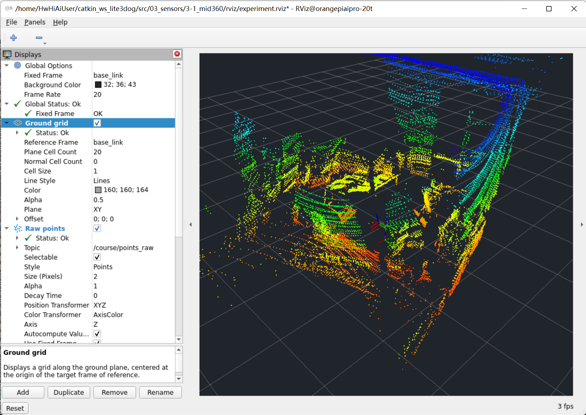
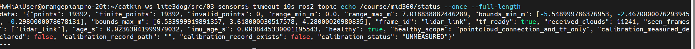

# 实验原理

MID360用激光回波生成点云。ROS 2的`PointCloud2`包含XYZ及可选的强度、时间等字段；XYZ单位为米，坐标属于`header.frame_id`。本实验原样转发原始消息至`/course/mid360/preview`，统计时只读XYZ，不删掉原消息字段。

数据路径是“以太网设备 → 官方Livox驱动 → 课程适配器 → `/course/points_raw` → 本节点/RViz”。安装外参由`base_link -> lidar_link`及`base_link -> imu_link`表示；机身姿态由`base_footprint -> base_link`表示。正x向前、正y向左、正z向上。RViz依靠采样时刻的TF把点云放到固定坐标，不能只把frame名称改成base_link。

# 实验目的

- 学会区分网络、驱动、话题、TF和显示问题。
- 识别空点云、NaN、过期消息与错误外参。
- 用JSON和RViz截图保留可核查的诊断证据。

# 实验步骤

本章先完成 **MID360 接入并在 RViz 中持续显示真实点云**。使用当前 Lite3 和已安装的课程程序，不再运行旧版 `camera_mid360` 相机雷达合章的启动命令。安装精度对比、地面高度校核和短包采集放到后续章节，不作为本章显示点云的前置条件。

## 1．确认本机环境

本次已验证的环境如下，Linux 命令在开发板终端执行。

| 项目 | 本机配置 |
|---|---|
| 开发板 | `orangepiaipro-20t`，Ubuntu 22.04 / ROS 2 Humble |
| SSH 用户与地址 | `HwHiAiUser@192.168.1.10`，走 Wi-Fi |
| 主工作空间 | `~/catkin_ws_lite3dog` |
| 课程源码目录 | `~/catkin_ws_lite3dog/src/03_sensors/3-1_mid360` |
| 本章 ROS 包 | `lite3_lab_3_1` |
| ROS 域 | `ROS_DOMAIN_ID=43` |
| 雷达设备地址 | `192.168.1.3` |
| 主机雷达网口 | `eth1 / 192.168.1.50` |
| RViz 点云话题 | `/course/points_raw` |
| 安装坐标关系 | `base_link → lidar_link`，由当前课程运行发布 |

雷达需要独立供电：9～27 V 直流，推荐 12 V；接电前核对线序和极性，电源应留出启动功率余量，不能把插网线当作已经供电。官方资料入口为 [Livox MID360 下载页](https://www.livoxtech.com/mid-360/downloads)。

当前网络已经配置好，本章只检查，不修改。保留 Wi-Fi SSH 与其他章节会话；机器狗控制网 `192.168.2.1 / 主机192.168.2.233` 与雷达网分开，不能把雷达网口改到控制网。

在开发板图形桌面，或已启用 X11 转发的 MobaXterm 终端中操作。普通无图形转发的 SSH 能检查话题，但不会自动显示 RViz 窗口。

## 2．加载环境并检查雷达连接

**每个新终端都先执行：**

```bash
source ~/catkin_ws_lite3dog/course_env.sh
export ROS_DOMAIN_ID=43
```

课程包和驱动已经安装，本次不需要重新创建包或重复构建。确认课程包存在，再从雷达网口指定源地址检查连接：

```bash
ros2 pkg prefix lite3_lab_3_1
ip -br -4 address
ping -c 3 -W 2 -I 192.168.1.50 192.168.1.3
```

本次 ping 为 3 发 3 收。ping 通说明链路可达，是否有点云还要看下一步话题。不要在本章执行旧版文档中的创建网卡连接、换网段或修改路由命令。

## 3．启动采集与 RViz：二选一

### A．已有采集进程：只打开 RViz

**本次 SSH 已保留一份后台采集，优先走这条路径。** 先检查：

```bash
source ~/catkin_ws_lite3dog/course_env.sh
export ROS_DOMAIN_ID=43

ros2 topic info /course/points_raw
timeout 10s ros2 topic hz /course/points_raw
```

若 `Publisher count: 1`，并持续收到约 10 Hz 点云，只打开显示窗口：

```bash
rviz2 -d "$(ros2 pkg prefix --share lite3_lab_3_1)/rviz/experiment.rviz"
```

这条命令只启动 RViz，不再启动第二份驱动。若话题不存在或发布者为 0，先确认所有终端均已加载环境、使用域 43；若主机重启后确实没有采集，再走 B。

### B．主机重启、当前没有采集：启动一份完整运行

以下使用本机已经保存的临时参数文件，新终端不会自动继承旧终端变量。

```bash
source ~/catkin_ws_lite3dog/course_env.sh
export ROS_DOMAIN_ID=43

SITE="$HOME/catkin_ws_lite3dog/real_configs/mid360_temp_cloud_height_20261021_212303"
source "$SITE/params.env"

if pgrep -f '[/]livox_ros_driver2_node' >/dev/null; then
  printf '%s\n' '已有 Livox 驱动运行，请按 A 复用，不要重复启动。'
else
  ros2 launch lite3_lab_3_1 experiment.launch.py \
    mode:=real native_execute:=false enable_real_motion:=false \
    rviz:=true publish_sensor_tf:=true \
    lidar_xyz:="$LIDAR_XYZ" lidar_rpy:="$LIDAR_RPY" \
    initial_body_height:="$BODY_HEIGHT" \
    params_file:="$SITE/experiment_params.yaml"
fi
```

保持此终端运行。正常日志可见 `Init lds lidar success!`、`livox/lidar publish use livox custom format` 和适配器收到首帧的提示。课程运行没有开启运动执行。

当前实际数据链路为：

```text
MID360 → 官方驱动 /livox/lidar（CustomMsg）
       → 课程适配器 /course/points_raw（PointCloud2）
       → 本章诊断节点与 RViz
```

所以 `/livox/lidar` 是自定义消息属于正常现象。RViz 选择 `/course/points_raw`，不要为了显示而另开旧版驱动或修改 `xfer_format`。

当前没有其他节点发布真实安装 TF，因此使用 `publish_sensor_tf:=true`。以后若本体 URDF 或其他节点已发布同一组真实安装 TF，改成 `publish_sensor_tf:=false`，并继续传入同一组安装参数；不要重复发布，也不要删除本体 URDF。雷达 JSON 外参保持零。

公共 JSON 路径可用下列命令查看，当前无需编辑：

```bash
printf '%s\n' "$(ros2 pkg prefix --share lite3_course_common)/config/MID360_config.json"
```

## 4．在 RViz 中设置显示

展开左侧 **Global Options**，修改它下面的 **Fixed Frame** 属性，输入 `base_link` 并回车。下拉框没有列出时可以直接输入。

**不要点 `Global Status → Fixed Frame → OK`。** 这里的 `OK` 只是状态；真正可修改的是上方 `Global Options` 下面的属性。

按下面设置：

| 位置 | 设置 |
|---|---|
| Global Options → Fixed Frame | `base_link` |
| Ground grid → Reference Frame | `base_link` 或 `<Fixed Frame>` |
| Ground grid → Offset | 本章先设 `0; 0; 0`，作为机身坐标参考 |
| Raw points | 勾选；若没有此项，Add → PointCloud2 |
| Raw points → Topic | `/course/points_raw` |
| Raw points → Topic → Reliability Policy | `Best Effort` |
| Raw points → Topic → Durability Policy | `Volatile` |
| Raw points → Position Transformer | `XYZ` |
| Raw points → Style / Size (Pixels) | `Points` / `2` |
| Raw points → Color Transformer / Axis | `AxisColor` / `Z` |
| Raw points → Decay Time | `0` |
| TF frames | 可勾选，观察坐标轴 |

鼠标拖动旋转视角，滚轮缩放，观察墙面、桌椅等轮廓是否持续更新。需要看短时累积时，可将 `Decay Time` 调为 `1` 秒；这只是叠加显示，不是建图。

`Ground grid` 在这里是参考网格，不要求真实地面与它重合。**本章不用通过随机点击点云、移动网格或修改外参来对齐地面。**

## 5．确认数据与 TF 正常

另开终端执行：

```bash
source ~/catkin_ws_lite3dog/course_env.sh
export ROS_DOMAIN_ID=43

timeout 10s ros2 topic hz /course/points_raw

timeout 10s ros2 topic echo /course/imu --once \
  --qos-reliability best_effort

timeout 8s ros2 run tf2_ros tf2_echo base_link lidar_link

timeout 10s ros2 topic echo /course/mid360/status --once --full-length
```

本机已观察到：

- 点云约 **10 Hz**，常见单帧约 **2 万点**；点数、距离和范围会随场景变化。
- `base_link → lidar_link` 平移约 **[0.210, 0, 0.161308] m**，RPY 约 **[0, 0.338594, 0] rad**，即 pitch **19.4°**。
- 点云消息的 `frame_id` 仍为 `lidar_link`，RViz 通过 TF 将其显示到 `base_link`，不需要改消息的 frame 名称。
- 状态中 `tf_ready=true`、`healthy=true`，RViz 的 Global Status、Raw points 和 TF frames 显示 `OK`。

完整状态用 `--full-length` 查看，否则终端可能用省略号截断。`healthy=true` 表示点云连接和 TF 可用，不表示安装精度已经标定。

首次运行 `tf2_echo` 可能先提示 `frame does not exist`，随后打印变换，这是等待发现 TF 的过程；若持续没有变换才需要排查。上述带 `timeout` 的检查到时退出、出现终止信号提示属于正常结束。

MID360 的 IMU 可能输出占位姿态 `[0,0,0,1]`，课程消息用 `orientation_covariance[0]=-1` 表示没有姿态解算。本章看到角速度和加速度持续输出即可，不据此判定雷达已经水平。

## 6．保存结果并结束

创建本次结果目录，保存完整状态和 TF 输出：

```bash
source ~/catkin_ws_lite3dog/course_env.sh
export ROS_DOMAIN_ID=43

OUT="$HOME/catkin_ws_lite3dog/results/3_1_rviz_$(date +%Y%m%d_%H%M%S)"
mkdir -p "$OUT"

timeout 10s ros2 topic echo /course/mid360/status --once --full-length \
  > "$OUT/status.yaml"
timeout 8s ros2 run tf2_ros tf2_echo base_link lidar_link \
  > "$OUT/tf_base_lidar.txt" 2>&1

printf '本次结果目录：%s\n' "$OUT"
```

保存一张能够同时看到 **Fixed Frame、点云话题、OK 状态和点云画面** 的截图。需要保留 RViz 设置时，用 **File → Save Config As** 保存为本次目录里的 `rviz_pass.rviz`。

走 A 时，关闭 RViz 只停止显示，后台采集继续运行。走 B 时，在启动该 launch 的终端按 `Ctrl+C` 停止自己启动的采集。不要使用全局 `pkill`，也不要结束其他章节会话。

# 实验结果

本章满足以下三项即可完成“接入与点云可视化”验证：

1. `/course/points_raw` 持续收到点云，约 10 Hz。
2. `base_link → lidar_link` 可查询，状态 `tf_ready=true`、`healthy=true`。
3. RViz 以 `base_link` 为固定坐标显示真实点云，相关显示项为 `OK`，并保存截图和状态输出。

2026-10-21 的本机操作已验证这条数据链路。下面保留实际调试截图，具体数值以当次结果文件为准。



上图为此前已经改成 `base_link` 的实际显示记录，Global Status、Ground grid 和 Raw points 均为 `OK`；它作为接收与显示证据，不作为地面高度或安装精度证明。目录中的旧 `点云图.png` 保留为调试过程记录。



上图中 `healthy=true`、`tf_ready=true`，同时 `calibration_status=UNMEASURED`。该截图拍摄时尚未填写记录路径；后续已保存记录文件，当前仍保留 `UNMEASURED`，这不影响本章验证点云接收和显示。

# 常见问题

| 现象 | 处理方法 |
|---|---|
| `ros2: command not found` 或包找不到 | 当前终端重新加载 `course_env.sh`，检查包名是否为 `lite3_lab_3_1`。 |
| ping 通但没有点云 | 检查是否只有一份驱动、JSON 接收地址是否仍为 `.50`，并核对实际驱动日志；不要仅凭 ping 判断有数据。 |
| 另一个终端能收到，本终端收不到 | 两边均重新加载课程环境，并确认 `ROS_DOMAIN_ID=43`。 |
| `/livox/lidar` 是 CustomMsg | 本课程的正常配置；RViz 使用 `/course/points_raw`。 |
| 只看到 Fixed Frame 的 `OK`，不知道在哪里修改 | 展开上方 Global Options，修改其下的 Fixed Frame 属性；Global Status 内的 OK 不能编辑。 |
| `Frame [lidar_link] does not exist` 或 `queue is full` | 先确认点云持续到达，再查 `base_link → lidar_link`。持续缺 TF 时核对发布者；本机没有其他真实安装 TF 发布者时，课程使用 `publish_sensor_tf:=true`。不要另加一份零值 TF。 |
| 状态正常但画面空白 | 检查 Raw points 是否勾选、话题是否正确、Reliability 是否为 Best Effort，并缩放或旋转视角。 |
| `Stereo is NOT SUPPORTED` | 普通点云仍能显示时无需处理，这是渲染提示。 |
| 出现 `[INFO]: command not found` | 将日志误粘贴成了命令；只执行代码框中的命令，不执行终端输出行。 |
| 没有 RViz 窗口，或提示无法连接显示 | 使用开发板图形桌面，或检查 MobaXterm X Server / SSH X11 转发。无图形会话仍可用话题命令检查数据。 |
| 地面与网格不重合，随机点击坐标差别很大 | 网格只是参考；不同点可能属于桌椅、墙面等。本章不靠随机点验收地面高度，留到后续单独比较。 |
| `healthy=true` 但 `calibration_status=UNMEASURED` | 正常：连接/TF 已通过，安装精度仍未独立验证；不要为了改变状态而直接将标定标志设为 true。 |

# 当前参数记录与后续章节

本次先采用点云估计的光学原点距地砖高度 **489.4 mm**，作为临时试验基准，后续可替换。489.4 mm 是光学原点高度，不能直接填到 `BODY_HEIGHT`。

| 参数 | 本次运行值 |
|---|---|
| `LIDAR_XYZ` | `[0.210,0,0.161308]` m |
| `LIDAR_RPY` | `[0,0.338594,0]` rad，总 pitch 19.4° |
| 光学原点距地砖高度 | 临时采用 `0.4894` m |
| `BODY_HEIGHT` | `0.325504965` m，已按本次平均重力方向换算，参考面为地砖 |
| 雷达 JSON 外参 | 保持零 |
| `calibration_measured` | `false` |
| `calibration_status` | `UNMEASURED` |

本机参数目录为：

```text
~/catkin_ws_lite3dog/real_configs/mid360_temp_cloud_height_20261021_212303/
├── params.env
├── measurement_record.json
├── experiment_params.yaml
├── start_sensor.sh
├── runtime.log
└── verification.json
```

保留此前实测记录：机壳中部顶面距泡沫垫面 388.8 mm、光学原点垂直高于该顶面 93.8 mm、垫厚 8.4 mm。临时点云估计不能覆盖成独立实测值，也不能用同一组估计值互相证明标定准确。

本章到这里即可结束。3-2 再做坐标参考比较和短包采集，3-3 再检查地面高度；若继续复用当前传感器运行，按对应章节使用 `start_runtime:=false`，不要重新开一份硬件驱动。当前临时参数与测量记录一并保留，换安装或换姿态后重新确认高度参考。
