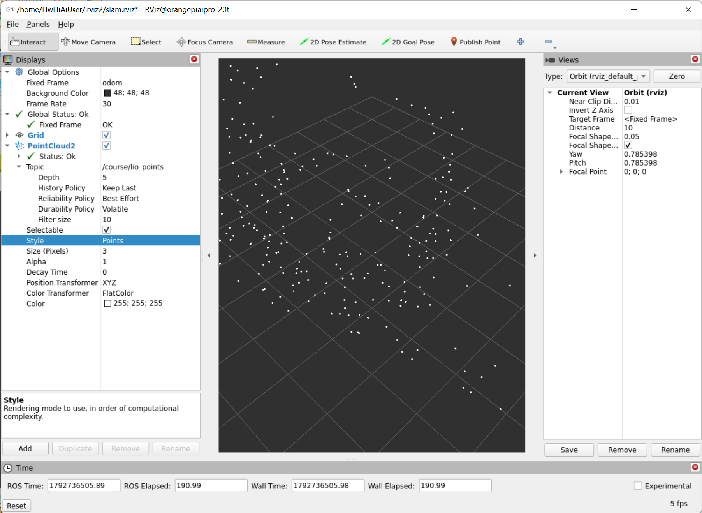
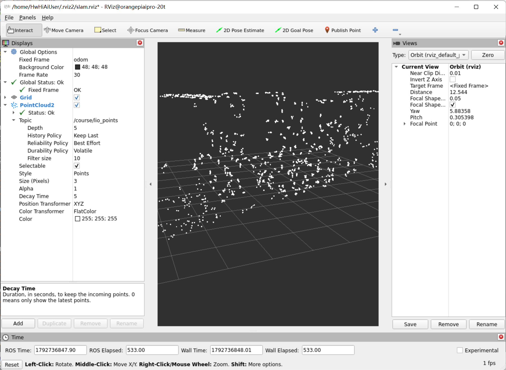

# 室内三维SLAM建图操作简版

## 实验目标

1. 建立真实激光、IMU、LIO里程计和点图链路，检查单位、时钟和安装外参。
2. 用实际地面起点和朝向完成三次同路线闭环，记录失败、时延和漂移。
3. 保存ASCII PCD并重读点数和有限XYZ，区分请求发出与保存成功。

## 实验原理

本课在Orange Pi上调用真实MID-360与官方FAST-LIO ROS2后端。激光提供环境几何，IMU在激光帧之间预测运动，LIO估计机身轨迹并将真实点配准到局部地图。本包Python负责健康监测、三次闭环记录和PCD保存，不生成替代里程计。

| 输入/输出 | 意义 |
|---|---|
| `/livox/lidar` | 官方CustomMsg，保留真实逐点offset，直接送LIO |
| `/course/points_raw` | 同源PointCloud2，用于观察和录制 |
| `/course/imu` | 仅转换一次的SI IMU：m/s²、rad/s；姿态不可用时明确标记 |
| `/course/odom` | LIO实际估计的base_link轨迹 |
| `/course/lio_points` | 配准点云，本课不要求二维`/map` |
| `/course/trajectory` | 从同一份odom机身估计生成的显示轨迹，不代替试验CSV |
| `/course/save_pcd` | 保存有界体素缓存并实际重载点数据 |

先静置初始化；教学`StreamMonitor`收集100个IMU样本检查模长均值8.5～11m/s²和标准差<0.8m/s²，四路数据还须保持新鲜。这只说明输入基本健康，精度和运动去畸变要另做实测。LIO局部地图采用120m窗口、30m检测参数，满足`cube/2 > 1.5×det_range`；树只存实际点，不预分配整个空窗口。

## 1 准备环境并构建

当前课程环境和驱动已安装，源码修改后也已完成构建。普通重启跳过本节。首次部署时，按课程环境安装说明配置ROS、Livox SDK2、Livox ROS Driver2和FAST-LIO ROS2；已安装在 `~/devices_driver` 的驱动直接使用。

缺少课程依赖时执行一次：

```bash
source /opt/ros/humble/setup.bash
sudo apt-get update
sudo apt-get install -y ros-humble-desktop python3-colcon-common-extensions \
  python3-numpy python3-yaml python3-pil python3-matplotlib python3-pytest \
  ros-humble-slam-toolbox ros-humble-navigation2 ros-humble-nav2-bringup \
  ros-humble-pointcloud-to-laserscan ros-humble-teleop-twist-keyboard
```

以下仅供首次部署或后续源码变更后使用；已完成本次显示修复时跳过，不重复执行native构建、测试和colcon构建：

```bash
cd ~/catkin_ws_lite3dog
source ./course_env.sh
bash src/lite3_course_native/native/build_backend.sh --test
colcon build --symlink-install \
  --base-paths src/lite3_course_native src/lite3_course_common src/03_sensors src/04_slam \
  --packages-up-to lite3_lab_4_1
source ./course_env.sh
export ROS_DOMAIN_ID=43
ros2 pkg prefix livox_ros_driver2
ros2 pkg prefix fast_lio
```

每个新终端先执行以下两行；所有终端与驱动保持同域，本简版统一使用43：

```bash
source ~/catkin_ws_lite3dog/course_env.sh
export ROS_DOMAIN_ID=43
```

### 当前已生效的减负配置

课程 `src/lite3_course_common/lite3_course_common/bringup.py` 每次启动会生成本轮 `lio_runtime.yaml`。本次已修改、构建并在新节点上核对：

| 参数 | 修改前 | 当前值 |
| --- | --- | --- |
| `point_filter_num` | 1 | 3 |
| `filter_size_surf` | 0.1 m | 0.5 m |
| `filter_size_map` | 0.1 m | 0.5 m |

此前 `/Odometry` 和 `/course/odom` 均延迟约2.1秒，减负并正常重启后降至几十毫秒。当前配置会减少地图细节，需随结果保存；后续若试用更小体素，要重新检查延迟和健康状态。普通重启保留已修改的源码，不需要再次替换参数。

源码变更后，仅重建公共包时可执行；当前已做过，无需重复：

```bash
cd ~/catkin_ws_lite3dog
source ./course_env.sh
colcon build --symlink-install \
  --base-paths src/lite3_course_common \
  --packages-select lite3_course_common
source ./course_env.sh
```

参数在后端启动时读入，修改文件后需正常重启本次launch。不要只修改运行中生成的旧YAML，或仅凭动态参数设置返回成功就认定算法已切换。

## 2 核对网络与本次安装参数

当前沿用3-3中确认的安装参数，雷达JSON外参保持零。坐标轴为x前、y左、z上，长度单位米、角度单位弧度。

| 项目 | 当前采用值 | 说明 |
| --- | --- | --- |
| ROS域 | `43` | 每个终端及驱动保持一致 |
| 雷达设备 | `192.168.1.3` | 雷达网口 `eth1 / 192.168.1.50/24` |
| Wi-Fi连接 | `192.168.1.10` | 保留现有远程连接 |
| 雷达位置 | `[0.210,0,0.161308]` m | `base_link`到雷达光学原点 |
| 雷达RPY | `[0,0.338594,0]` rad | 安装角 |
| 机身高度 | `0.325504965` m | `base_link`原点距地面高度 |
| 对称包络长度 | `0.674` m | 指定站姿的模型参考 |
| 对称包络宽度 | `0.375` m | 指定站姿的模型参考 |
| 额外余量 | `0.1` m | 用户本次填写值，尚未据此验证行走包络 |
| 雷达JSON | `$(ros2 pkg prefix --share lite3_course_common)/config/MID360_config.json` | 本次运行实际使用的公共配置；使用独立JSON时改为其绝对路径 |

包络按官方Lite3模型的躯干、四腿与足部可视网格及碰撞几何计算，`base_link`与官方 `TORSO` 重合，四腿均取 `HipX=0、HipY=-0.7、Knee=1.4` 弧度。前后范围约为 `[-0.336517,0.278800]` m，左右约为 `[-0.187001,0.187001]` m；以原点为中心向外取整，采用上述长宽。

这是指定站姿下的模型范围，未包含加装附件，也未覆盖行走时的摆腿全过程。运动前另核对实际完整包络和余量。雷达安装、附件或站立高度变化后，重新核对并更新参数文件。

网络仅按现有配置检查；机器狗控制网 `192.168.2.1 / 主机192.168.2.233` 与雷达网分开。第3节统一保存参数并启动，不再依赖容易在新终端丢失的 `REAL_ARGS` 数组。

## 3 启动静态检查与重启后完整流程

### 3.1 创建缺失的参数文件并检查环境

给MID-360供电并接好网线。通过原来的远程桌面或SSH连接开发板。RViz需要开发板图形桌面或已启用图形转发的连接。

新开终端A，完整执行下面这段。它会在文件缺失时创建参数文件；已有文件保留，然后加载课程环境。后面的节点和进程检查都在加载环境之后执行：

```bash
mkdir -p "$HOME/catkin_ws_lite3dog/real_configs"
if [ ! -f "$HOME/catkin_ws_lite3dog/real_configs/lab4_1_env.sh" ]; then
  cat > "$HOME/catkin_ws_lite3dog/real_configs/lab4_1_env.sh" <<'ENV'
source "$HOME/catkin_ws_lite3dog/course_env.sh"
export ROS_DOMAIN_ID=43
export LIDAR_CONFIG="$(ros2 pkg prefix --share lite3_course_common)/config/MID360_config.json"
export LIDAR_XYZ='[0.210,0,0.161308]'
export LIDAR_RPY='[0,0.338594,0]'
export BODY_HEIGHT=0.325504965
# 指定站姿的模型包络；行走前另核对。
export ROBOT_LENGTH=0.674
export ROBOT_WIDTH=0.375
# 此前填写的额外余量。
export FOOTPRINT_PADDING=0.1
ENV
fi

source ~/catkin_ws_lite3dog/real_configs/lab4_1_env.sh
cd ~/catkin_ws_lite3dog

ros2 pkg prefix lite3_lab_4_1
ros2 pkg prefix fast_lio
test -f "$LIDAR_CONFIG"
ip -br -4 address
ping -c 3 -W 2 -I 192.168.1.50 192.168.1.3
```

`test -f` 成功时没有输出。确认包可找到、JSON存在，当前雷达网口和设备地址仍与此前一致；网络检查失败时先排查连接和供电。

### 3.2 检查已有运行并处理占用

检查是否已有课程LIO或雷达驱动：

```bash
ps -eo pid,lstart,args | grep -E '[f]astlio_mapping|[l]io_starter|[/]livox_ros_driver2_node'
```

- 重启后没有自动采集服务时，通常没有输出，继续第3.3节。
- 若已有 `fastlio_mapping` 或 `lio_starter`，先确认是谁启动的。继续使用自己正在运行的4-1实验时，按下方方法找回结果目录，然后跳到第3.4节；需要重启时，回原launch终端按 `Ctrl+C`，等待退出后再启动。
- 只有外部雷达驱动已运行时，第3.3节会自动选择复用该驱动。驱动应与本课同为域43。

确认现有运行是自己的4-1实验后，找回当前目录：

```bash
unset RESULT_DIR
RUN_DIR="$(ros2 param get /lab_4_1 result_dir | sed -n 's/^String value is: //p')"
if [ -n "$RUN_DIR" ] && [ -f "$RUN_DIR/health.json" ]; then
  RESULT_DIR="$RUN_DIR"
  printf '%s\n' "$RESULT_DIR" > "$HOME/catkin_ws_lite3dog/real_configs/lab4_1_current_run.txt"
  echo "当前结果目录：$RESULT_DIR"
else
  echo '未取得当前实验目录，先核对节点和域43，等待初始化后重试。'
fi
```

若出现“公共运行时已被占用”，报错中的PID和结果目录用于确认当前持有者。需要重启自己旧的4-1实验时，优先回原launch终端按 `Ctrl+C`，等待旧进程退出；原终端找不到时，可以按以下步骤正常停止对应的4-1父launch。PID每次都可能变化，不照抄历史PID：

```bash
read -r -p '输入本次占用报错中的旧4-1 launch PID：' OLD_PID
case "$OLD_PID" in
  ''|*[!0-9]*) echo 'PID必须是数字，本段未停止任何进程。' ;;
  *)
    OLD_CMD="$(ps -p "$OLD_PID" -o args=)"
    if [[ "$OLD_CMD" == *"ros2 launch lite3_lab_4_1 experiment.launch.py"* ]]; then
      echo "正在正常停止：$OLD_CMD"
      kill -INT "$OLD_PID"
    else
      echo '未匹配到4-1父launch，请保留输出核对。'
      ps -p "$OLD_PID" -o pid,lstart,args
    fi
    ;;
esac
```

上面仅适用于本节静态会话；运动会话先按第6节停车、交还并确认CLOSED。等待约10秒，再运行本节开头的进程检查，确认自己的旧LIO已退出后才启动新实例。保留锁文件，不使用 `start_runtime:=false` 绕过重新加载配置，也不误停其他章节程序。

`start_runtime:=false` 仅适用于明确复用已有完整公共LIO、TF和相关栈的情形；只有原始雷达驱动运行时不满足该条件。

只复制代码块中的命令执行。`eth1 UP 192.168.1.50/24` 等网卡信息是输出，不是命令。

### 3.3 终端A启动静态建图

终端A运行后保持打开。使用站姿初始高度时，先用原遥控站稳、保持静止，再启动；以下命令创建独立目录，终端B从实验节点取得实际路径。创建目录不代表启动成功。

```bash
source ~/catkin_ws_lite3dog/real_configs/lab4_1_env.sh

START_HARDWARE=true
if pgrep -f '[/]livox_ros_driver2_node' >/dev/null; then
  START_HARDWARE=false
fi

mkdir -p "$HOME/catkin_ws_lite3dog/results"
RESULT_DIR="$(mktemp -d "$HOME/catkin_ws_lite3dog/results/4_1_static_XXXXXXXX")"
echo "本次结果目录：$RESULT_DIR"
echo "本次启动雷达驱动：$START_HARDWARE"

ros2 launch lite3_lab_4_1 experiment.launch.py \
  mode:=real start_hardware:="$START_HARDWARE" \
  lidar_config:="$LIDAR_CONFIG" \
  lidar_xyz:="$LIDAR_XYZ" lidar_rpy:="$LIDAR_RPY" \
  initial_body_height:="$BODY_HEIGHT" \
  robot_length_m:="$ROBOT_LENGTH" robot_width_m:="$ROBOT_WIDTH" \
  footprint_padding_m:="$FOOTPRINT_PADDING" \
  native_execute:=false enable_real_motion:=false \
  autostart:=false rviz:=false \
  result_dir:="$RESULT_DIR"
```

保持设备静止，等约10秒及FAST-LIO初始化完成。若程序报错退出，先处理报错；创建结果目录本身不代表启动成功。

### 3.4 终端B核对本轮参数与健康状态

另开终端B，先加载环境，再从正在运行的 `/lab_4_1` 读取实验结果目录。每次重启A或重新打开B，都执行本段。先清除旧变量，最多尝试3次；未取得有效目录时不继续读文件，也不启动第二份launch。

```bash
source ~/catkin_ws_lite3dog/real_configs/lab4_1_env.sh
unset RESULT_DIR

for ATTEMPT in 1 2 3; do
  RUN_DIR="$(timeout 8s ros2 param get /lab_4_1 result_dir 2>/dev/null | sed -n 's/^String value is: //p')"
  if [ -n "$RUN_DIR" ] && [ -f "$RUN_DIR/health.json" ]; then
    RESULT_DIR="$RUN_DIR"
    break
  fi
  sleep 2
done

if [ -n "${RESULT_DIR:-}" ] && [ -f "$RESULT_DIR/health.json" ]; then
  printf '%s\n' "$RESULT_DIR" > "$HOME/catkin_ws_lite3dog/real_configs/lab4_1_current_run.txt"
  echo "当前结果目录：$RESULT_DIR"
  ros2 param get /course_sensor_adapter use_sim_time
  ros2 param get /laser_mapping point_filter_num
  ros2 param get /laser_mapping filter_size_surf
  ros2 param get /laser_mapping filter_size_map
  ros2 param get /lite3_course_continuous_adapter execute
  timeout 8s ros2 topic hz /course/points_raw
  timeout 8s ros2 topic hz /course/imu
  timeout 8s ros2 topic hz /course/odom
  timeout 8s ros2 topic delay /course/odom
  cat "$RESULT_DIR/health.json"
else
  echo '未取得有效实验目录。先确认A正常运行、域号43、初始化完成，再重试本段。'
  ros2 node list
fi
```

`Node not found`表示查询当时未发现对应节点，需结合启动进度、域号和节点列表判断。此前出现该提示后，目录变量没有赋值，单独执行cat才误读为 `/health.json`；不能据此认定建图或健康检查失败。`timeout`检查到时退出是正常现象。

| 检查项 | 本轮应满足 |
| --- | --- |
| `use_sim_time` | `False`，真机系统时间 |
| `point_filter_num` | `3` |
| 两个filter_size | 都为 `0.5` |
| 连续适配器execute | `False`，软件运动输出关闭 |
| 健康文件 | `ready=true`、`initialized=true`、`stale_streams=[]` |
| IMU检查 | 模长均值8.5～11 m/s²、标准差小于0.8 m/s² |

参数里的两个False是正确设置，不要改成True。若健康文件中的ready或initialized为false，先保持站稳、按第8节排查，不开始路线。

### 3.5 终端C直接加载已完成的显示配置

**本机显示配置已完成，直接加载，不再点击Add添加同一份点云，不再手动改成FlatColor或大方块。** 在有图形桌面的终端C执行：

```bash
source ~/catkin_ws_lite3dog/real_configs/lab4_1_env.sh
RVIZ_CFG="$HOME/catkin_ws_lite3dog/real_configs/lab4_1_remote_view.rviz"
if [ -f "$RVIZ_CFG" ]; then
  rviz2 -d "$RVIZ_CFG"
else
  rviz2 -d "$(ros2 pkg prefix --share lite3_lab_4_1)/rviz/experiment.rviz"
fi
```

RViz已打开且正确时继续使用，不再打开第二个窗口。若误加显示项，先取消勾选或删除额外的 `PointCloud2`；也可以通过 `File → Open Config` 重新加载上述文件，不保存错误改动。

| 已配置显示项 | 用途与设置 | 你需要做什么 |
| --- | --- | --- |
| `LIO Height Color` | `/course/lio_points`；XYZ；AxisColor按Z高度着色；Points、1像素、Decay Time 2秒；Best Effort | 保持勾选，不新增同话题显示 |
| `Robot Trajectory` | `/course/trajectory`；绿色连续线；odom坐标系 | 保持勾选，真实运动后观察延长 |
| `Robot Position Heading` | `/course/odom`；只保留1个小朝向箭头 | 保持勾选，不另加一堆历史箭头 |
| `Raw Points` | `/course/points_raw`原始点云对照 | 平时关闭，需要比较时才切换 |
| `Grid` | odom网格 | 按需保留 |

固定坐标系保持 `odom`。彩色表示不同高度，不是相机RGB真彩色。绿色轨迹从有效机身里程计生成，不需要另加FAST-LIO原始 `/path`，避免其camera_init坐标与课程odom不一致。

静止时可能只有一个起点或很短的线；实际移动后轨迹才会延长。显示轨迹最多保留5000个采样点、约1Hz发布，重启节点后重新开始；完整试验CSV仍按原流程保存。

如果希望保存视角，确认上述显示正确后再保存到：

```text
/home/HwHiAiUser/catkin_ws_lite3dog/real_configs/lab4_1_remote_view.rviz
```

若出现 `requesting incompatible QoS`、`Last incompatible policy: RELIABILITY`，表示某个新订阅者要求Reliable，与点云发布端的Best Effort不兼容。只有该订阅者收不到点云，不表示雷达停止发布，也不能据此判定本轮记录或PCD保存失败。

在当前RViz窗口修正已有显示项，不需要新增PointCloud2：

1. 展开Topic为 `/course/lio_points` 的 `LIO Height Color` 或已有PointCloud2显示项。
2. 在 `Topic → Reliability Policy` 选择 **Best Effort**，`Durability Policy` 保持 **Volatile**。如有额外同话题显示项，取消重复项。
3. `Robot Trajectory`保持 **Reliable / Transient Local**，不跟随点云改成Best Effort。无需修改点云发布代码。
4. 通过 `File → Save Config As` 保存到上方的 `lab4_1_remote_view.rviz` 路径，后续直接加载。

若当前点云已经是Best Effort、显示正常，且修改后没有新增警告，切换前的历史警告保留即可，不需要重启建图或重跑已经完成的三轮。若仍有新增警告，查看实际订阅者，核对是否还有其他Reliable点云订阅：

```bash
ros2 topic info /course/lio_points -v
ros2 topic info /course/trajectory -v
```

打开RViz后在终端B复查，目录无效时先重新执行第3.4节：

```bash
timeout 8s ros2 topic delay /course/odom
if [ -n "${RESULT_DIR:-}" ] && [ -f "$RESULT_DIR/health.json" ]; then
  cat "$RESULT_DIR/health.json"
else
  echo '结果目录未取得，请重新执行第3.4节，不读取根目录下的health.json。'
fi
```

### 3.6 理解点云密度与历史显示对照

当前抽点参数为 `point_filter_num=3`，体素为 `0.5 m`，配准点云因此较稀疏。点大小、颜色和Decay Time只改变显示，不改变测量精度或后端点云密度。

**当前默认是彩色、Points、1像素、Decay Time 2秒，不需要再改。** Decay Time为0时只显示最新一帧，为5时叠加近5秒数据；增加保留时长会增加显示负担，不等于显示整场累计地图。

下面两图是此前白色单帧与5秒叠加的历史对照，保留作说明，不要照图恢复旧的FlatColor或3像素设置。





两图视角不同，不能据此量化精度。第二图约1 fps是RViz渲染帧率，不是ROS点云发布频率。当前显示卡顿时，先只显示配准点云并保持2秒，不另加重复点云。

需要对照原始密度时，使用已经配置好的 `Raw Points`，与 `LIO Height Color` 分别勾选查看。后续试用更细体素须按第1节改参数并正常重启，重新比较细节、延迟和健康；不为显示好看直接改回此前导致高延迟的配置。

### 3.7 保存静态点云并结束本轮

静态点云已经显示，接下来在终端B发起保存。此项仍需实际执行并核对最终结果：

```bash
ros2 service call /lab_4_1/save_pcd std_srvs/srv/Trigger '{}'
```

稍后查看结果；若仍在处理，再次查看，不要连续重复发保存请求：

```bash
cat "$RESULT_DIR/pcd_save_result.json"
```

看到 `success=true`、`reload_valid=true`，且点数大于0，才算保存成功。随后将默认地图及配套文件复制到本轮目录：

```bash
mkdir -p "$RESULT_DIR/map_snapshot"
for f in "$HOME"/catkin_ws_lite3dog/maps/robot_dog_auto_map*; do
  if [ -f "$f" ]; then
    cp -p -- "$f" "$RESULT_DIR/map_snapshot/"
  fi
done
```

默认PCD为 `~/catkin_ws_lite3dog/maps/robot_dog_auto_map.pcd`。下一次保存可能更新同名地图，因此本轮应保留副本。

只做静态实验时，保存RViz截图与配置，然后回终端A按 `Ctrl+C`，等待主程序退出，再关闭RViz。本轮结果在 `$RESULT_DIR` 中。

## 4 使用原遥控器边走边建图

原遥控器负责站立、行走、转向、停车与趴下；FAST-LIO负责建图和里程计，RViz负责显示，`start_trial`等服务只负责记录。全程保持 `native_execute:=false`、`enable_real_motion:=false`，不需要arm、键盘控制、零速度发布或Nav2。

**操作顺序：旧会话正常退出 → 加载配置 → 原遥控站稳 → A启动一次 → B检查本轮数据 → C加载现成显示 → 按第5节记录三轮。**

### 4.1 正常退出旧会话

先用原遥控停车，整理线缆，在空旷区域准备路线。根据当前状态处理：

- 整机重启后没有采集程序运行：继续第4.2节。
- 已在运行本节的遥控建图，目录、初始化和健康检查正确：继续使用当前会话，直接检查第4.4节，不再开第二份launch。
- 需要从静态检查切换或重新做一批：先处理当前保存和活动轮次，再回原终端A按一次 `Ctrl+C`，等待各子进程退出、终端恢复提示符。单独启动的RViz可以保留。
- 旧软件运动后端已确认 `CLOSED`：保持关闭，退出自己之前启动的键盘或零速度发布程序，再正常退出旧launch。
- 旧软件运动后端仍为armed或running：先完成下面的交还步骤，再退出旧launch。

仅旧软件运动会话尚未交还时执行：

```bash
source ~/catkin_ws_lite3dog/course_env.sh
export ROS_DOMAIN_ID=43
ros2 service call /course/native/handover std_srvs/srv/Trigger '{}'
```

按原遥控交还流程让机器狗趴下，再检查实际状态：

```bash
timeout 8s ros2 topic echo /course/native/status \
  --once --field data --full-length
```

确认 `state=CLOSED`、`armed=false`、`running=false`，再结束旧控制发布程序、正常退出旧launch。本节始终关闭软件运动输出，正常遥控建图不用每次执行handover。

**退出整套旧launch，不单独用pkill停止雷达，也不用kill -9结束父launch。** 父进程消失不代表LIO和适配器已退出；原终端找不到或启动检查仍报残留时，按第4.6节核对，不删除锁文件。

### 4.2 保存并加载遥控建图配置

以下配置与第3节静态配置分开保存，避免每次被旧站姿包络覆盖。在终端A执行；已有同名文件时保留，不自动覆盖：

```bash
mkdir -p "$HOME/catkin_ws_lite3dog/real_configs"
if [ ! -f "$HOME/catkin_ws_lite3dog/real_configs/lab4_1_remote_env.sh" ]; then
cat > "$HOME/catkin_ws_lite3dog/real_configs/lab4_1_remote_env.sh" <<'ENV'
source "$HOME/catkin_ws_lite3dog/course_env.sh"
export ROS_DOMAIN_ID=43
export LIDAR_CONFIG="$(ros2 pkg prefix --share lite3_course_common)/config/MID360_config.json"
export LIDAR_XYZ='[0.210,0,0.161308]'
export LIDAR_RPY='[0,0.338594,0]'
export BODY_HEIGHT=0.325504965
export ROBOT_LENGTH=0.779
export ROBOT_WIDTH=0.480
export FOOTPRINT_PADDING=0.10
ENV
fi

source ~/catkin_ws_lite3dog/real_configs/lab4_1_remote_env.sh
```

长 `0.779 m`、宽 `0.480 m` 来自两批低速行走数据的已观测模型包络，附件由操作者确认未超出前后各38.95厘米、左右各24厘米的边界；不代表所有步态、速度的最大尺寸。`0.10 m`沿用本次实验余量，不是已测得的制动距离。安装外参和机身高度沿用本次配置。

这些公共启动参数不会限制原遥控器速度，也不会提供自动避障。后续保持已记录的低速步态与挡位。原遥控器直接控制机器狗，本流程不需要再启动关节UDP记录器或软件运动后端。

### 4.3 终端A启动一份完整建图程序

若终端带有 `(base)`，先执行 `conda deactivate`。加载环境并检查雷达网络：

```bash
source ~/catkin_ws_lite3dog/real_configs/lab4_1_remote_env.sh
ros2 pkg prefix lite3_lab_4_1
ros2 pkg prefix fast_lio
test -f "$LIDAR_CONFIG" && echo '雷达JSON文件存在'
ip -br -4 address
ping -c 3 -W 2 -I 192.168.1.50 192.168.1.3
```

确认网络正常，用原遥控让机器狗站稳、保持静止，再执行下面一段。初始高度使用站姿值；此前若趴着初始化，现在改为站姿，应按第4.1节正常退出后重新启动。

**默认由本轮统一启动雷达和LIO，固定使用 `start_hardware:=true`、`start_runtime:=true`。不再根据pgrep输出自动复用驱动。**

```bash
(
  set -e
  source ~/catkin_ws_lite3dog/real_configs/lab4_1_remote_env.sh
  cd ~/catkin_ws_lite3dog
  test -f "$LIDAR_CONFIG"

  mkdir -p "$HOME/catkin_ws_lite3dog/results"
  RESULT_DIR="$(mktemp -d "$HOME/catkin_ws_lite3dog/results/4_1_remote_XXXXXXXX")"
  echo "本次结果目录：$RESULT_DIR"

  ros2 launch lite3_lab_4_1 experiment.launch.py \
    mode:=real start_runtime:=true start_hardware:=true \
    lidar_config:="$LIDAR_CONFIG" \
    lidar_xyz:="$LIDAR_XYZ" lidar_rpy:="$LIDAR_RPY" \
    initial_body_height:="$BODY_HEIGHT" \
    robot_length_m:="$ROBOT_LENGTH" robot_width_m:="$ROBOT_WIDTH" \
    footprint_padding_m:="$FOOTPRINT_PADDING" \
    native_execute:=false enable_real_motion:=false \
    autostart:=false rviz:=false \
    map:="$RESULT_DIR/remote_map.yaml" \
    result_dir:="$RESULT_DIR"
)
```

只执行一次，终端A保持打开，站稳静止约10秒，等待IMU检查通过和LIO初始化。创建了结果目录不代表启动成功；若程序退出，按报错处理，不继续读取这个空目录。

程序会自动检查冲突进程并使用公共运行时锁，发现冲突就停止本次启动。它不会替你清理旧进程，也不能代替对其他计算机上发布者的检查。

仅在明确使用独立启动的雷达驱动、确认其JSON正确、域号43且数据持续更新时，才把上述命令中的 `start_hardware:=true` 改为 `false`；启动检查要求本机同用户恰好一个同域驱动、没有其他域驱动和冲突建图进程。普通流程保持true。不要用 `start_runtime:=false` 绕过残留或运行时占用报错。

### 4.4 终端B核对当前目录与数据

若有 `(base)`，先执行 `conda deactivate`。另开终端B，执行以下整段；先清除旧目录变量，再从正在运行的实验节点获取实际目录。每次重启A都重新执行：

```bash
source ~/catkin_ws_lite3dog/real_configs/lab4_1_remote_env.sh
unset RESULT_DIR

for ATTEMPT in 1 2 3; do
  RUN_DIR="$(timeout 8s ros2 param get /lab_4_1 result_dir 2>/dev/null | sed -n 's/^String value is: //p')"
  if [ -n "$RUN_DIR" ] && [ -f "$RUN_DIR/health.json" ]; then
    RESULT_DIR="$RUN_DIR"
    break
  fi
  sleep 2
done

if [ -n "${RESULT_DIR:-}" ] && [ -f "$RESULT_DIR/health.json" ]; then
  printf '%s\n' "$RESULT_DIR" > "$HOME/catkin_ws_lite3dog/real_configs/lab4_1_current_run.txt"
  echo "当前结果目录：$RESULT_DIR"
  ros2 param get /course_sensor_adapter use_sim_time
  ros2 param get /laser_mapping point_filter_num
  ros2 param get /laser_mapping filter_size_surf
  ros2 param get /laser_mapping filter_size_map
  ros2 param get /lite3_course_continuous_adapter execute
  ros2 topic info /livox/lidar
  ros2 topic info /livox/imu
  ros2 topic info /Odometry
  ros2 topic info /course/lio_points
  timeout 8s ros2 topic delay /course/odom
  cat "$RESULT_DIR/health.json"
else
  echo '未取得有效目录。检查A的报错、域号43及初始化状态，再重试本段；不要启动第二份launch。'
  ros2 node list
fi
```

`Node not found`表示查询时未发现节点，先看A是否正常启动；不是重新安装的依据。目录变量为空时执行cat会误读 `/health.json`，不要创建这个文件，也不要用旧目录的ready代替本轮结果。`timeout`到时结束检查正常。

| 检查项 | 本轮应满足 |
| --- | --- |
| 结果目录 | B读出的目录与A本次成功启动的目录一致 |
| `use_sim_time` | `False`，真机使用系统时间 |
| `point_filter_num` | `3` |
| `filter_size_surf`、`filter_size_map` | 都为 `0.5` |
| 连续适配器 `execute` | `False`，软件运动输出关闭 |
| 上述四个话题的 `Publisher count` | 每个为 `1`；大于1时先排查重复发布 |
| 健康文件（开轮前） | `ready=true`、`initialized=true`、`stale_streams=[]` |
| 静置确认（开轮前） | `imu_stationary_ready=true`、`health_phase=stationary_check` |
| 时间戳与日志 | 无持续回退警告，`invalid_stamps`不持续增加 |
| 里程计延迟 | 最近短时复测均值约36.5毫秒，记录本轮实际值 |

参数里的两个False是正确设置，不要改成True；`backend_ready=false`在原遥控方案中也不需要arm解决。健康未就绪时先停车、保持站稳约10秒再查；持续回退按第4.6节处理，其他健康异常按第8节处理，不开始路线、不放宽阈值。

健康检查现在按记录阶段区分：

| 阶段 | 应如何判断 |
| --- | --- |
| 开轮前、结束时 | 保持站稳静止，IMU模长均值8.5～11 m/s²、标准差小于0.8 m/s²；正常开始或结束须同时满足 `ready=true`、`imu_stationary_ready=true` |
| `start_trial`成功后 | `health_phase=recording`；继续检查四路数据新鲜度、时间戳、有效样本和非有限数值 |
| 行走期间 | 加速度均值和标准差继续记录；仅 `imu_stationary_ready=false` 不代表断流，`ready`仍可能为true |
| 出现真实数据异常 | 查看 `health_reasons` 和本轮 `data_faults`；恢复ready不会清除已经记录的故障 |

行走中的ready只表示当前数据检查通过，不代表已经停车或地图精度合格。每轮结束按第5.2节等待停稳检查，不只看ready就立即结束。

### 4.5 终端C使用现成的彩色点云与轨迹

已经运行正确配置的RViz时继续使用；没有时执行：

```bash
source ~/catkin_ws_lite3dog/real_configs/lab4_1_remote_env.sh
RVIZ_CFG="$HOME/catkin_ws_lite3dog/real_configs/lab4_1_remote_view.rviz"
if [ -f "$RVIZ_CFG" ]; then
  rviz2 -d "$RVIZ_CFG"
else
  rviz2 -d "$(ros2 pkg prefix --share lite3_lab_4_1)/rviz/experiment.rviz"
fi
```

按第3.5节确认已有的 `LIO Height Color`、`Robot Trajectory`、`Robot Position Heading` 已勾选即可。**不用再Add PointCloud2或Odometry，不手动改回白色、3像素或0.1米方块。** 误加重复项时取消勾选或删除，保留现成配置。

原遥控低速移动时，**绿色线表示走过的轨迹，小箭头表示当前位置和朝向**；完整机器狗模型需要另加载URDF。真实运动仍由原遥控控制，不使用RViz的2D Goal Pose。

### 4.6 启动冲突或时间戳回退时恢复

此前在只停止雷达、强制结束父launch后出现持续回退，最符合旧子进程残留与新数据流混用的情况；当时没有完整发布者记录，不能只凭日志确定是哪一个进程造成。`lidar loop back, clear buffer`在FAST-LIO中也可能由IMU时间戳回退触发；地图缓存反复清空时，不能继续当作正常建图。

| 终端A提示 | 处理方式 |
| --- | --- |
| 启动前检查发现已有LIO、适配器、回放或原生执行进程 | 本次启动已被拦截。确认PID对应的旧会话，回原终端正常退出；不要重复运行启动命令 |
| 已有Livox驱动，拒绝第二份 | 普通流程先正常退出旧驱动所属的launch，再用第4.3节统一启动；只有已核对的独立驱动才按第4.3节复用 |
| 公共运行时已被占用 | 按报错PID和目录确认持有者，正常退出对应旧会话；不删锁、不绕过运行时检查 |
| 持续出现 `lidar loop back` 或 `LIO点云时间回退` | 先原遥控停车；活动轮次按第5节据实结束，保留报错和记录，再正常退出整套launch，核对残留和发布者后新建会话 |

原终端找不到、已经强制结束过父launch，或正常退出后仍提示冲突时，执行只查看的检查，保留完整输出：

```bash
source ~/catkin_ws_lite3dog/real_configs/lab4_1_remote_env.sh
ps -eo pid,ppid,lstart,args | grep -E '[s]ensor_adapter|[l]io_starter|[m]ap_archive|[f]astlio_mapping|[l]ivox_ros_driver2_node|[n]ative_runner|[r]os2 bag play'
ros2 node list
ros2 topic info /livox/lidar -v
ros2 topic info /livox/imu -v
```

确认进程归属后优先回其原终端正常退出；不能确认时先保留上述输出，不对未知进程使用批量pkill或kill -9。锁文件留在磁盘上本身不表示仍被占用，不手动删除。

自己的旧采集进程都退出后，重新按第4.3节启动一次，B按第4.4节获取新目录并检查。仍有回退时，继续核对各话题发布者与原始时间戳，不把消息时间改为当前时间、不放宽健康阈值。若旧程序已退出、来不及结束活动轮次，保留原目录和中断情况，不在新会话补成旧轮次通过；重启后另用新目录。

## 5 遥控完成三轮路线并分别保存点云

地面标记起点A及起始朝向，选择可返回A的路线，每轮实际记录路程至少1米。三轮保持同一路线、低速步态和挡位。

**第一轮通过只说明第一轮的结果；第二、三轮复用相同操作，但仍须各自记录和核对。** “闭环”指现场实际回到A及原朝向，以记录漂移；服务不会自动控制机器狗返回，也不会自动开启FAST-LIO回环优化。

以下编号适用于一个新的结果目录。程序自动生成 `trial_01.json`、`trial_02.json`、`trial_03.json`，失败也占用轮次。`TRIAL`只是保存路径变量，重新填写 `01` 不会重置程序计数。

### 5.1 选择本轮编号并开始记录

第一轮先在终端B执行：

```bash
TRIAL=01
```

用原遥控器停在A点、对齐起始朝向并站稳。按第4.4节确认当前目录正确、健康文件持续更新，且 `ready=true`、`imu_stationary_ready=true` 后，终端B执行：

```bash
ros2 param set /lab_4_1 returned_to_start false
ros2 service call /lab_4_1/start_trial std_srvs/srv/Trigger '{}'
```

看到服务响应 `success=True` 后再移动。`start_trial`只开始本轮轨迹和健康记录；FAST-LIO从launch启动后一直在建图。

### 5.2 原遥控走路线并结束记录

原遥控低速完成路线，实际返回A点及原朝向后停车，保持站稳静止约2秒。仅位置回到A而朝向未恢复，不算实际返回；`returned_to_start`必须与现场情况一致。

**只有已实际返回A点及原朝向并停车后，才执行下面的正常结束段；未确认返回时使用下方故障收尾。** 其中的Python检查只读取本轮健康文件，最多等待20秒；文件须为最近3秒内更新，且 `ready=true`、`imu_stationary_ready=true`，后面的命令才会结束记录。检查未通过时不会执行正常结束命令。

```bash
if python3 - "$RESULT_DIR" <<'PY'
from pathlib import Path
import json
import sys
import time

if not sys.argv[1].strip():
    raise SystemExit("RESULT_DIR为空，请重新执行第4.4节。")
path = Path(sys.argv[1]).expanduser() / "health.json"
deadline = time.monotonic() + 20
last = {}
while time.monotonic() < deadline:
    try:
        last = json.loads(path.read_text(encoding="utf-8"))
        age = time.time() - path.stat().st_mtime
    except (FileNotFoundError, json.JSONDecodeError):
        time.sleep(1)
        continue
    if "imu_stationary_ready" not in last:
        raise SystemExit("缺少修复后的健康字段，请核对本轮目录及终端A是否已正常重启。")
    if not 0 <= age <= 3:
        time.sleep(1)
        continue
    if last.get("health_phase") != "recording":
        raise SystemExit("当前不在记录阶段，请先核对本轮trial文件，不重复结束。")
    if last.get("ready") is True and last.get("imu_stationary_ready") is True:
        print("停稳检查通过，结束本轮记录。")
        break
    time.sleep(1)
else:
    print("最近健康状态：", json.dumps(last, ensure_ascii=False))
    raise SystemExit("停稳检查未通过；保持停车，按第8.1节排查或按下方故障收尾。")
PY
then
  ros2 param set /lab_4_1 returned_to_start true &&
    ros2 service call /lab_4_1/finish_trial std_srvs/srv/Trigger '{}'
  cat "$RESULT_DIR/trial_${TRIAL}.json"
else
  echo '本段未结束记录。先核对健康和现场返回情况，不重新调用start_trial。'
fi
```

**未返回或故障收尾：** 如果未实际回到A及原朝向，或已停车但健康持续不恢复，仍需结束当前轮次、保留失败记录，不必一直等待正常检查通过。仅在已经停车、当前轮次尚未结束时执行下面一段；是否返回只按现场位置和朝向填写，不能因健康失败一律填false，也不能为了通过填true：

```bash
read -r -p '是否实际回到A点及原朝向？输入true或false：' RETURNED_ACTUAL
case "$RETURNED_ACTUAL" in
  true|false)
    ros2 param set /lab_4_1 returned_to_start "$RETURNED_ACTUAL" &&
      ros2 service call /lab_4_1/finish_trial std_srvs/srv/Trigger '{}'
    cat "$RESULT_DIR/trial_${TRIAL}.json"
    ;;
  *) echo '输入应为true或false，本段未结束记录。' ;;
esac
```

结束服务响应 `success=True` 表示记录已写入，不等于本轮通过。查看JSON中的 `success`、`errors`、`data_faults`、`path_length_m` 和漂移。只有本轮 `success=true` 才算程序判定通过；此前出现的真实数据故障不会因停车后ready恢复而消失。

如果服务等待响应时按过 `Ctrl+C`，先查看实际文件。文件已生成说明该轮可能已经结束，再次调用提示“没有进行中的试验”时不重复操作。结束记录后再执行第5.3节保存；试验失败和点云保存失败是两项不同结果。

### 5.3 指定本轮路径并请求保存

本轮记录结束、机器狗停车后，先设置路径，看到参数设置成功，再发保存请求：

```bash
ros2 param set /course_map_archive map_path "$RESULT_DIR/map_trial_${TRIAL}/map.pcd"
ros2 service call /lab_4_1/save_pcd std_srvs/srv/Trigger '{}'
```

服务应返回“异步保存请求已发出”。**必须先执行这两条，再执行下面的检查脚本；检查脚本本身不会发起保存。**

```bash
python3 - "$RESULT_DIR" "$TRIAL" <<'PY'
from pathlib import Path
import json
import shutil
import sys
import time

root = Path(sys.argv[1]).expanduser().resolve()
trial = sys.argv[2]
expected = root / f"map_trial_{trial}" / "map.pcd"
report = root / "pcd_save_result.json"
deadline = time.monotonic() + 60

while time.monotonic() < deadline:
    try:
        result = json.loads(report.read_text(encoding="utf-8"))
    except (FileNotFoundError, json.JSONDecodeError):
        time.sleep(1)
        continue
    if result.get("pending"):
        time.sleep(1)
        continue
    if not result.get("success"):
        raise SystemExit("保存未通过，请查看：" + json.dumps(result, ensure_ascii=False))
    actual = Path(result.get("pcd", "")).expanduser().resolve()
    if actual != expected.resolve():
        raise SystemExit("结果不属于本轮目标文件，请核对保存服务响应与map_path：" + str(actual))
    if result.get("reload_valid") is not True or result.get("point_count", 0) <= 0:
        raise SystemExit("重载或点数检查未通过：" + json.dumps(result, ensure_ascii=False))
    if not expected.is_file():
        raise SystemExit("报告中的PCD文件不存在：" + str(expected))
    shutil.copy2(report, expected.parent / "save_result.json")
    print("本轮保存通过：", expected)
    print("点数：", result["point_count"], "坐标系：", result.get("frame"))
    break
else:
    raise SystemExit("仍未取得保存结果。保持launch运行，查看pcd_save_result.json，暂不重复请求。")
PY
```

以 `pending=false`、`success=true`、`reload_valid=true`、`point_count>0` 和本轮正确路径为准。脚本通过后，会把保存报告复制到本轮目录的 `save_result.json`。

若等待超时，保持launch运行，查看：

```bash
cat "$RESULT_DIR/pcd_save_result.json"
```

仍为 `pending=true` 时等待，不重复请求；报告不存在时确认是否漏掉了保存服务。保存已失败则按 `error` 排查。本轮保存完成前不修改下一轮路径。

每轮目录包含 `map.pcd`、`map.pcd.frame.json`、`map.pcd.frame.txt` 和 `save_result.json`。三次PCD是同一LIO会话中的累计快照，不是三次从零独立重建。

### 5.4 第二轮与第三轮

第一轮记录和保存处理完成，且健康检查正常后，第二轮先设置：

```bash
TRIAL=02
```

从第5.1节的 `returned_to_start false` 开始，重复开始记录、原遥控走同一路线、返回并停车、结束记录和第5.3节保存；保持本轮变量为 `02`。查看的是 `trial_02.json`，保存到 `map_trial_02`。

第三轮先设置：

```bash
TRIAL=03
```

执行相同流程，查看 `trial_03.json`，保存到 `map_trial_03`。不再执行第一轮的 `TRIAL=01`。

如果前一轮出现健康异常，先按第8节排查再继续，不把当前ready当成全过程合格。本目录最多记录三轮，失败记录保留；需要补做一整批时，正常退出后新建结果目录，不删除失败文件。

### 5.5 核对三轮汇总

```bash
cat "$RESULT_DIR/three_trial_summary.json"
ls -l "$RESULT_DIR"/trial_*.json
ls -l "$RESULT_DIR"/trajectory_*.csv
ls -l "$RESULT_DIR"/map_trial_*/map.pcd
```

确认 `trial_count=3`，查看 `success_count` 和 `all_pass`。三轮记录都通过时 `all_pass=true`，每轮PCD保存还需单独通过重载检查。程序通过不代替现场返回确认或额外地图精度要求。

## 6 正常停车与断线恢复

### 6.1 原遥控器会话正常退出

1. 原遥控停车，确认机身不再移动。
2. 如仍有活动轮次，按实际返回情况设置标志并执行 `finish_trial`。
3. 等最后一次保存及重载检查完成，保留记录、PCD和截图。
4. 原遥控正常让机器狗趴下。
5. 回终端A按 `Ctrl+C`，等待launch正常退出。
6. 保存RViz配置，再关闭终端C。

本节遥控会话的native始终 `execute=false`，无需arm，也无需为退出再执行handover或等待 `CLOSED`。第3.2节涉及旧真实执行会话的交还，按第4.1节处理；只做静态检查仍按第3.7节退出。

### 6.2 SSH断线后恢复

先用原遥控器停车。`Software caused connection abort`只说明远程连接断开，不能据此判断launch是否停止，暂不再调用 `start_trial`。

重新连接香橙派后执行：

```bash
source ~/catkin_ws_lite3dog/real_configs/lab4_1_remote_env.sh
ros2 node list
ros2 param get /lab_4_1 result_dir
```

节点仍在时，按第4.4节重新取得实际目录、检查健康和已生成的试验文件。若断线前已经开始一轮、该轮未完成真实返回，就结束为未返回记录：

```bash
ros2 param set /lab_4_1 returned_to_start false
ros2 service call /lab_4_1/finish_trial std_srvs/srv/Trigger '{}'
```

只有确实完成返回A点及原朝向时才使用true。若服务提示“没有进行中的试验”，先看已生成文件，不反复结束或开始。

节点已退出时，先保存原目录材料，再按第4节创建新会话。不要把旧路径文件里的健康状态当作新会话状态。

## 7 保存材料与本次实际结果

当前终端丢失目录变量时，重新按第4.4节从实验节点获取。仅查阅已保存材料时可以读取路径文件：

```bash
source ~/catkin_ws_lite3dog/real_configs/lab4_1_remote_env.sh
RESULT_DIR="$(cat "$HOME/catkin_ws_lite3dog/real_configs/lab4_1_current_run.txt")"
echo "$RESULT_DIR"
```

保留 `health.json/csv`、`lio_runtime.yaml`、`parameters.json`、三轮 `trial_XX.json` 和 `trajectory_XX.csv`、`trials.json`、`three_trial_summary.json`、各轮PCD及坐标系文件、各轮 `save_result.json`、RViz配置与截图。记录雷达JSON、外参、低速步态与挡位、路线、包络、余量、安装照片和实验日期，注明0.5米体素。

**本次复测结果（2026年10月25日）：** 会话目录为 `~/catkin_ws_lite3dog/results/4_1_remote_FeVtKb4c`。

汇总文件为 `trial_count=3`、`success_count=3`、`all_pass=true`；三轮均正常结束，`errors=[]`、`data_faults=[]`，开轮与结束时健康及静置检查通过。三轮PCD均为 `success=true`、`reload_valid=true`、`pending=false`，坐标系为 `odom`。

| 轮次 | 记录路程 | 起终点位置差 | 起终点航向差 | PCD点数 | 记录与保存 |
| --- | --- | --- | --- | --- | --- |
| 1 | 25.40 m | 14.75 cm | 29.43° | 115645 | 均通过 |
| 2 | 20.85 m | 10.02 cm | 0.25° | 167801 | 均通过 |
| 3 | 27.58 m | 9.29 cm | 0.73° | 195565 | 均通过 |

本次可确认三轮流程记录及点云保存通过。当前程序的 `all_pass` 没有按地图几何误差或位置、航向漂移阈值验收，不能直接等同于地图精度达标。第一轮航向差29.43°应单独保留并核对停车时是否恢复原朝向；若现场已对齐，需进一步检查航向漂移。三轮是否严格使用同一实际路线仍由现场确认。

日志中的一次RELIABILITY警告按第3.5节处理，不改变上述已经成功的记录和保存结果。

**历史记录（2026年10月24日）：** 以下为此前A、B终端输出，保留作对照，不作为本次复测状态：

| 项目 | 已取得结果 |
| --- | --- |
| 本次实际会话 | `~/catkin_ws_lite3dog/results/4_1_remote_01Na4EkO` |
| 雷达与FAST-LIO | 已初始化，软件运动输出 `execute=false` |
| 一次短时里程计延迟 | 平均约0.034秒，不能替代全过程检查 |
| 第一轮 | 约90.46秒、6.30米；`health:unready`，`success=false` |
| 第二轮 | 约81.03秒、8.50米；`health:unready`，`success=false` |
| 已保存点云 | `map_trial_01/map.pcd`，104022点，`odom`，重载通过 |
| 已保存点云的时间 | 在第二次结束记录之后保存，不能作为第一轮结束时的独立快照 |
| 第三次开始记录 | 日志显示已开始，随后SSH断开，需按第6.2节确认是否结束 |
| 三轮全部通过 | 尚未确认，不能由某一轮成功推定 |

此前第二次记录后仍使用 `TRIAL=01`，导致查看旧的第一轮JSON、点云也保存到 `map_trial_01`；后端实际轮次仍自动递增。后续新批次按第5节的01、02、03对应保存。

上述历史结果保留；后续是否改善以新生成的实际记录为准。漂移只有在真实返回A及原朝向后才有相应意义。PCD一般在 `odom` 下，以 `.frame.json` 为准，不能直接当作Nav2二维地图。

## 8 健康异常与操作问题排查

### 8.1 健康状态为false

先原遥控停车、保持站稳静止约10秒，保留终端A，然后在B执行：

```bash
source ~/catkin_ws_lite3dog/real_configs/lab4_1_remote_env.sh
ros2 node list
RESULT_DIR="$(ros2 param get /lab_4_1 result_dir | sed -n 's/^String value is: //p')"

if [ -n "$RESULT_DIR" ] && [ -f "$RESULT_DIR/health.json" ]; then
  echo "当前结果目录：$RESULT_DIR"
  cat "$RESULT_DIR/health.json"
else
  echo '未找到有效健康文件，先检查终端A。'
fi

timeout 8s ros2 topic hz /course/imu
timeout 8s ros2 topic hz /course/odom
```

- `health_phase=stationary_check`：开轮前仍检查100个有效IMU样本，均值8.5～11 m/s²、标准差小于0.8 m/s²。不通过时先检查是否站稳、样本和单位是否正确。
- `health_phase=recording`：行走期间不再用静置均值和标准差判定整轮失败；`imu_stationary_ready=false`可以由行走加速度引起，不能单独据此认定断流。正常结束前仍须停稳复核。
- 记录中 `initialized=false`：查看 `health_reasons`，例如有效样本不足或非有限IMU导致初始化核对状态撤销；不能用继续走动或调大阈值恢复本轮合格。
- `stale_streams`非空：结合对应话题的原始时间戳、接收年龄、无效帧和终端A日志判断。
- `health:unready`：说明记录过程中至少一次健康检查未通过。修复后的记录同时保留具体 `health_reasons`；先按原因排查，不笼统当成网络断流。
- 已停车但健康持续不恢复时，按第5.2节故障收尾，据实确认是否返回并结束记录。恢复ready不会清除该轮已经记录的真实故障，不修改失败JSON。

### 8.2 查看本轮健康异常发生时刻

确认B中的 `RESULT_DIR` 指向要检查的会话，执行只读分析：,.

```bash
python3 - "$RESULT_DIR" <<'PY'
from pathlib import Path
import csv
import json
import sys

root = Path(sys.argv[1]).expanduser()
with (root / "health.csv").open(newline="", encoding="utf-8") as f:
    health = list(csv.DictReader(f))

for path in sorted(root.glob("trial_*.json")):
    trial = json.loads(path.read_text(encoding="utf-8"))
    start, end = trial["start_ros_s"], trial["finished_ros_s"]
    bad = [row for row in health
           if start <= float(row["stamp_s"]) <= end
           and row["ready"].lower() != "true"]
    print("\n===", path.name, "===")
    print("是否通过：", trial.get("success"), "原因：", trial.get("errors"))
    print("健康异常采样次数：", len(bad))
    for row in bad[:10]:
        print("距开始秒数：", round(float(row["stamp_s"]) - start, 2),
              "过期流：", row["stale_streams"] or "无",
              "IMU就绪：", row["initialized"],
              "均值：", row["imu_norm_mean_mps2"],
              "标准差：", row["imu_norm_std_mps2"])
        print("阶段：", row.get("health_phase", "旧版未记录"),
              "静置检查：", row.get("imu_stationary_ready", "旧版未记录"),
              "具体原因：", row.get("health_reasons", "旧版未记录"))
PY
```

脚本读取已完成轮次的记录及每秒健康采样，不连接机器狗、不发送运动指令。结合异常时刻和终端A输出再排查。

### 8.3 其他问题速查

| 现象 | 处理 |
| --- | --- |
| `lab4_1_remote_env.sh`不存在 | 先执行第4.2节创建；不要误写为 `.shh` |
| `Package not found`或`Node not found` | 加载环境，核对域43及终端A状态，不立即重装或启动第二份 |
| 公共运行时被占用 | 确认旧会话，按第4.1节正常退出；不删锁、不用 `start_runtime:=false` 绕过 |
| `use_sim_time=False`、`execute=False` | 遥控建图正确设置；与健康文件中的ready区分 |
| `backend_ready=false` | 软件运动输出关闭，不需要arm；检查传感器健康 |
| 参数仍为1、0.1、0.1 | 核对实际配置和旧进程，确认新的launch加载了减负源码 |
| RViz QoS可靠性不兼容 | 使用现成配置，点云Best Effort、轨迹Reliable/Transient Local，见第3.5节 |
|                                       |                                                              |
| `cat: /health.json`不存在 | 目录变量为空，重做第3.4节，不创建根目录文件 |
| 加载配置后是否还要Add | 不需要；彩色点云、轨迹、小箭头已配置完成 |
| 点云稀疏或显示卡顿 | 先用2秒Decay Time、只显示配准点云；不要只为加密显示改大计算负载 |
| `start_trial`失败 | 按消息核对健康、活动轮次、返回标志和本目录已有记录数 |
| 第二轮仍看到第一轮JSON | 检查 `TRIAL` 和实际文件编号；变量不重置后端计数 |
| 结束服务等待后被中断 | 先检查是否已生成记录，避免重复结束 |
| 保存检查等待但报告不存在 | 先确认已执行设置路径和 `save_pcd`，检查脚本不会发起保存 |
| 保存返回成功 | 仍需等pending结束、重载通过且点数大于0 |
|                                       |                                                              |
|                                       |                                                              |
|                                       |                                                              |

可选算法检查仍可在开发板执行，不能替代三轮现场结果：

```bash
python3 -m pytest ~/catkin_ws_lite3dog/src/04_slam/4-1_lidar_inertial_mapping/tests -q
```

---

## 快速启动：室内三维 SLAM（香橙派原 4-1）

本地资料的目录或文件编号已调整；下面所有 Linux 路径、ROS 包名、节点名和阶段号仍沿用香橙派现有部署，不能随本地编号改写。所有命令在香橙派 Bash 终端执行。首次部署或环境缺失先完成正文；本节用于已有环境的日常重启。有 `(base)` 时先执行 `conda deactivate`。A/B/C 等表示不同终端，前台进程要保持运行，不把所有命令连续粘贴到一个终端。

### 1. 每个终端：加载原有遥控建图环境

保持原遥控控制，软件运动输出关闭。环境文件缺失时先按正文第 4.2 节恢复；安装与包络变化后先核对配置。

```bash
source "$HOME/catkin_ws_lite3dog/real_configs/lab4_1_remote_env.sh"
export ROS_DOMAIN_ID=43
```

### 2. A：检查设备并启动唯一建图会话

确认旧采集与建图程序已退出，雷达连通；用原遥控站稳静止后启动。保留 A，等待约 10 秒完成初始化。

```bash
source ~/catkin_ws_lite3dog/real_configs/lab4_1_remote_env.sh
ros2 pkg prefix lite3_lab_4_1
ros2 pkg prefix fast_lio
test -f "$LIDAR_CONFIG" && echo '雷达JSON文件存在'
ip -br -4 address
ping -c 3 -W 2 -I 192.168.1.50 192.168.1.3
```

```bash
(
  set -e
  source ~/catkin_ws_lite3dog/real_configs/lab4_1_remote_env.sh
  cd ~/catkin_ws_lite3dog
  test -f "$LIDAR_CONFIG"

  mkdir -p "$HOME/catkin_ws_lite3dog/results"
  RESULT_DIR="$(mktemp -d "$HOME/catkin_ws_lite3dog/results/4_1_remote_XXXXXXXX")"
  echo "本次结果目录：$RESULT_DIR"

  ros2 launch lite3_lab_4_1 experiment.launch.py \
    mode:=real start_runtime:=true start_hardware:=true \
    lidar_config:="$LIDAR_CONFIG" \
    lidar_xyz:="$LIDAR_XYZ" lidar_rpy:="$LIDAR_RPY" \
    initial_body_height:="$BODY_HEIGHT" \
    robot_length_m:="$ROBOT_LENGTH" robot_width_m:="$ROBOT_WIDTH" \
    footprint_padding_m:="$FOOTPRINT_PADDING" \
    native_execute:=false enable_real_motion:=false \
    autostart:=false rviz:=false \
    map:="$RESULT_DIR/remote_map.yaml" \
    result_dir:="$RESULT_DIR"
)
```

### 3. B：读取本轮目录并检查健康

A 每次重启都重做本步。应为真机时间、单一发布者、执行关闭；开始走测前须 ready=true、initialized=true、imu_stationary_ready=true，无断流和持续时间戳回退。

```bash
source ~/catkin_ws_lite3dog/real_configs/lab4_1_remote_env.sh
unset RESULT_DIR

for ATTEMPT in 1 2 3; do
  RUN_DIR="$(timeout 8s ros2 param get /lab_4_1 result_dir 2>/dev/null | sed -n 's/^String value is: //p')"
  if [ -n "$RUN_DIR" ] && [ -f "$RUN_DIR/health.json" ]; then
    RESULT_DIR="$RUN_DIR"
    break
  fi
  sleep 2
done

if [ -n "${RESULT_DIR:-}" ] && [ -f "$RESULT_DIR/health.json" ]; then
  printf '%s\n' "$RESULT_DIR" > "$HOME/catkin_ws_lite3dog/real_configs/lab4_1_current_run.txt"
  echo "当前结果目录：$RESULT_DIR"
  ros2 param get /course_sensor_adapter use_sim_time
  ros2 param get /laser_mapping point_filter_num
  ros2 param get /laser_mapping filter_size_surf
  ros2 param get /laser_mapping filter_size_map
  ros2 param get /lite3_course_continuous_adapter execute
  ros2 topic info /livox/lidar
  ros2 topic info /livox/imu
  ros2 topic info /Odometry
  ros2 topic info /course/lio_points
  timeout 8s ros2 topic delay /course/odom
  cat "$RESULT_DIR/health.json"
else
  echo '未取得有效目录。检查A的报错、域号43及初始化状态，再重试本段；不要启动第二份launch。'
  ros2 node list
fi
```

### 4. C：打开已有 RViz 配置

观察彩色点云、轨迹与当前位置；已有正确窗口则继续使用。遥控低速行走前先通过 B 的检查。软件不会因启动建图而控制本体。

```bash
source ~/catkin_ws_lite3dog/real_configs/lab4_1_remote_env.sh
RVIZ_CFG="$HOME/catkin_ws_lite3dog/real_configs/lab4_1_remote_view.rviz"
if [ -f "$RVIZ_CFG" ]; then
  rviz2 -d "$RVIZ_CFG"
else
  rviz2 -d "$(ros2 pkg prefix --share lite3_lab_4_1)/rviz/experiment.rviz"
fi
```

### 5. B：停车后保存一次点云

原遥控停车、站稳，保持 A 运行。在执行过第 3 步的 B 终端发请求，再等报告完成；pending 时只重查报告，不重复发保存请求。

```bash
ros2 service call /lab_4_1/save_pcd std_srvs/srv/Trigger '{}'
```

```bash
cat "$RESULT_DIR/pcd_save_result.json"
```

只有本次报告 success=true、reload_valid=true 且点数大于 0 才算保存成功。

### 6. B：保存本轮副本，再正常退出

确认上一步保存成功后再复制。正式三轮闭环记录按正文第 5 节逐轮 start_trial、finish_trial 并另存点云；本节启动和单次存图不等于完成三轮验收。

```bash
mkdir -p "$RESULT_DIR/map_snapshot"
for f in "$HOME"/catkin_ws_lite3dog/maps/robot_dog_auto_map*; do
  if [ -f "$f" ]; then
    cp -p -- "$f" "$RESULT_DIR/map_snapshot/"
  fi
done
```

保持停车，按原遥控正常流程趴下，再在 A 按 Ctrl+C，等待子进程退出后关闭 C。持续回退、LIO 异常或健康未通过时按正文故障流程保留证据。
